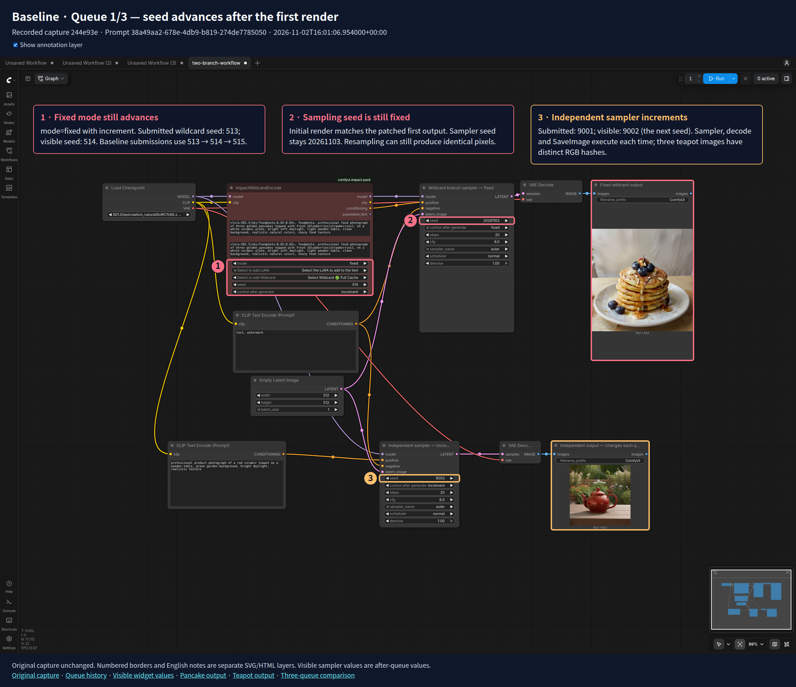
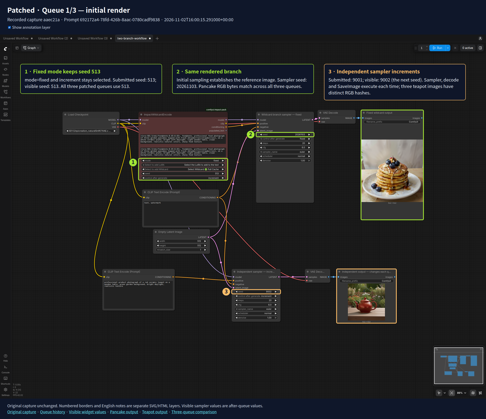
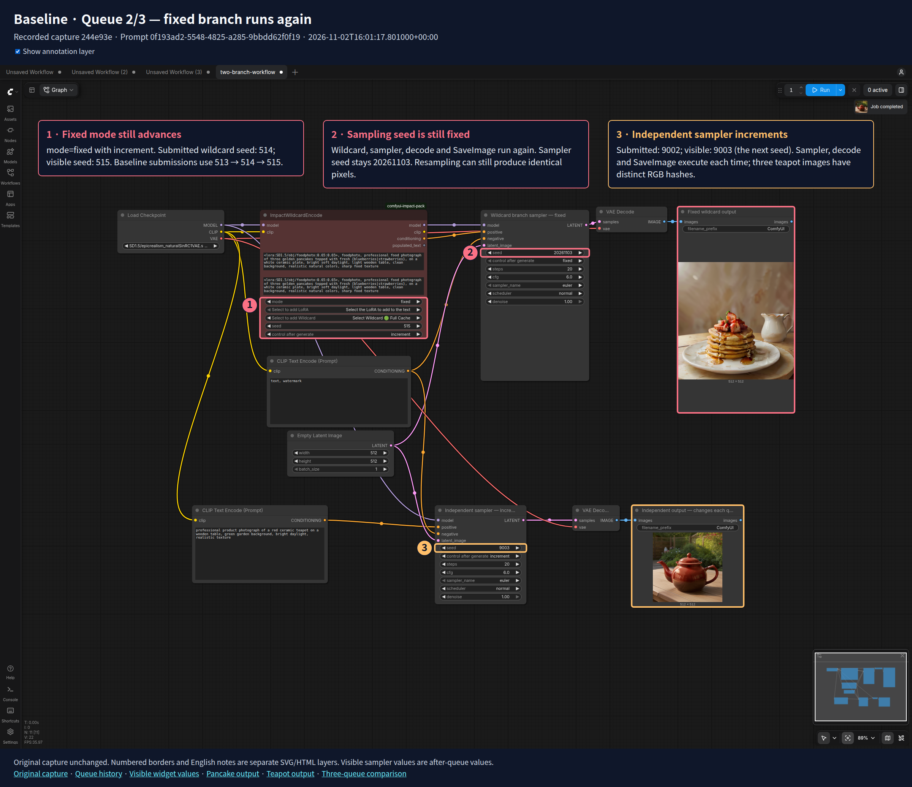
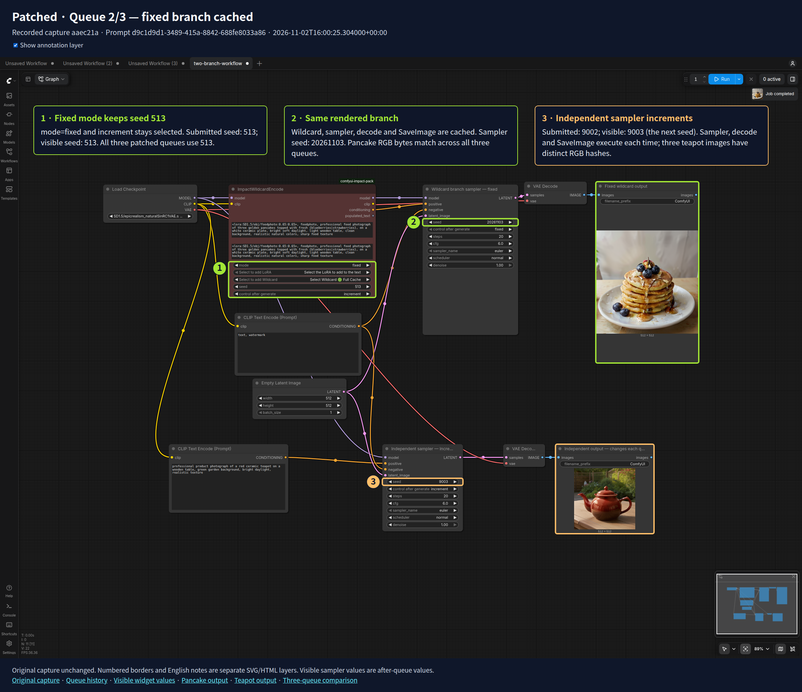
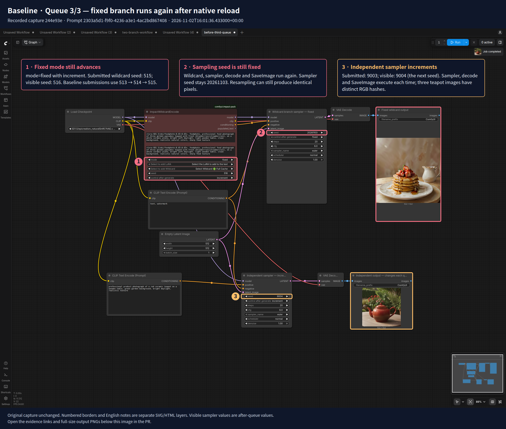
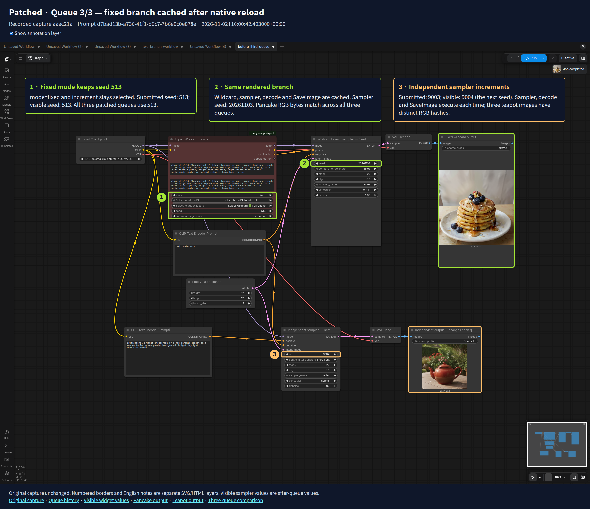

# Keep fixed wildcard nodes cached when automatic seed control is enabled

## Intent and scope

Issue [#513](https://github.com/ltdrdata/ComfyUI-Impact-Pack/issues/513) reports that
`mode=fixed` with `control_after_generate=increment` still changes the seed and
forces workflow regeneration. Fixed mode must prevent automatic seed changes from
invalidating an otherwise unchanged wildcard node and its downstream nodes.

Apply this behavior to `ImpactWildcardProcessor` and `ImpactWildcardEncode`, for
direct and linked populated text, including active wildcard syntax. Manually editing
the seed or text, or changing an upstream input, remains an intentional change that
can rerun the graph. Populate/reproduce retain their existing seed-control behavior.
The fix covers the node’s own automatic seed control. Subgraph-promoted seeds and
Inspire GlobalSeed use separate paths; their limitations are documented below.

Full-regression baseline: `244e93e`. PR head: `4819ada` (one commit).
The current target `Main` (`082523b`) merges cleanly with this head. A separate
merged-state check passed **205 wildcard/config unit tests, 20 Node tests and
16 Chrome cases** (12 edge cases plus positional/named fixed-widget restoration).
[Latest Main compatibility and exact commands](impact-pack-issue513-pr-assets/publication/compatibility.json).
Reload the browser to load the frontend change. No new node, widget or dependency.

## Changes

- During the seed control's existing `beforeQueued`/`afterQueued` callbacks, use the
  core `fixed` policy when wildcard mode is fixed. Restore the user's selected
  increment/decrement/randomize policy in `finally`, including when a callback fails.
- Call the existing core hooks so their queue bookkeeping survives. Outside fixed
  mode, forward their arguments, receiver and return value unchanged. Reuse the
  core seed algorithm; do not add custom arithmetic, RNG or persistent seed state.
- Preserve widget names/order and native saved values. The control tooltip explains
  that automatic seed changes pause in fixed mode; the user's selected policy resumes
  when leaving fixed.

The backend remains unchanged relative to the base commit.

## Verification

Real Chrome queues check unchanged fixed inputs for cache hits on the wildcard node
and downstream PreviewAny, then require a cache miss after text/manual seed changes.
Cases include plain text, comments, empty output, active choices and linked text,
with before/after control timing and increment/decrement/randomize. Transitions back
to populate verify that automatic updates resume with the core's normal timing.
Twelve additional Chrome cases cover changing the policy while fixed and resuming
it after native reload, explicit upstream seed changes, and three prompts submitted
by one Run click. Each case runs for both wildcard nodes and both control timings.

Node tests load the actual extension with core-hook spies. They check policy
selection, one-call delegation, receiver/argument/return forwarding, legacy false,
and both callbacks restoring the selected policy after an exception. They do not
model seed arithmetic; real Chrome queues check seed updates and core bookkeeping.
Native Export/reload checks widget names, order and saved values in positional and
named restoration modes; trusted catalog fixtures stay unchanged.

The earlier suite includes the original LBW tutorial and native restoration. The
current visual evidence reuses its graph topology with an installed foodphoto LoRA,
an active text choice, an independent incrementing sampler, and three real Chrome
queues per revision. Native Export/reload
precedes the third queue. The first baseline and candidate renders must match.

Environment: ComfyUI `7c4390a6`, frontend 1.57.6, Chrome 156, Python 3.12.3 and
Torch 2.10.0. The full regression uses isolated classic, LRU and cache-none servers,
CPU integrations and RTX 4080 real-model checks. Exact SAM pixel comparisons use
CPU for both the server and independent predictor. Installed models only; no downloads.
The retained foodphoto evidence uses deterministic CUDA/PyTorch attention, **SD1.5**
at **512 × 512**. Its production source is identical to this commit.

## Results

Full regression completed on the source committed as `4819ada`, using the stated
`244e93e` baseline. The focused merged-state check above additionally validates
compatibility with `Main` at `082523b`; the broad full suite was not repeated on
that temporary merge. All owned validation servers are stopped.

| Check | Result |
| --- | --- |
| Python unit suites | **366 passed**; browser harness **3 passed** |
| Node suites | **20 passed** |
| Trusted catalog | **14 passed**, covering **198 node records**, positional/named restoration |
| Wildcard Chrome, classic cache | All **63 test bodies passed**, including original LBW inference; one startup error was caught at teardown and the unchanged case passed **3 retries** |
| Wildcard Chrome, LRU cache | **37/38 passed initially**; one settings-menu timeout; unchanged case passed **3 retries**, covering all **38 scenarios** |
| Switch / Mask / LoRA source Chrome | **55 / 4 / 2 passed** |
| SAM masks, tutorials, legacy editor and API | **19 passed** after matching predictor/server devices and isolating legacy-editor extensions |
| Cache and tensor integrations | **8 cache groups, 5 real-model tensor groups, 3 tutorial tensor groups**, LoRA patch/conditioning tensors and input validation passed |
| Real render / native / API scripts | LoRA/core image parity, Detailer, Switch tutorial routes, Regional sampler, AnimateDiff native restoration, full-cache/on-demand wildcard UI and UTF-8 API passed |

The **12 new edge cases passed in both classic and LRU cache**. They cover policy
edits while fixed followed by native reload/resumption, intentional upstream seed
changes, and three prompts from one Run click. New batch RGR with the same frozen
test file was **4 failed → 4 passed → the same 4 failed**, with no errors or skips.
Ruff and whitespace checks passed. Production JavaScript and both trusted workflow
fixtures remain byte-for-byte identical to the earlier validated `aaec21a` revision.

This is **not an all-green raw repository run**. Five legacy failure items reproduce
on base `244e93e`: three Python assertions and two shell scenarios. Their causes are
outdated loaded-key expectations, two separate config-module instances, eagerly loaded
YAML data, and a missing fixture in a script that prints failure but exits zero.
They are recorded as pre-existing test defects, not changed in this seed-control PR.
The two browser incidents above, the initial SAM device mismatch and the legacy SAM
assertion triggered by Inspire's deprecated UI import are also retained. Assertions
and trusted references were not relaxed; corrected runs passed.

[Full results and exact commands](impact-pack-issue513-pr-assets/full-regression-20261103/summary.json)
· [Failure diagnosis and limits](impact-pack-issue513-pr-assets/full-regression-20261103/triage.md)
· [Batch RGR](impact-pack-issue513-pr-assets/full-regression-20261103/batch-rgr.json)
· [Tested source hashes](impact-pack-issue513-pr-assets/full-regression-20261103/candidate-source.json)
· [Final commit and source verification](impact-pack-issue513-pr-assets/full-regression-20261103/commit.json).

The unit regression check verified **8 failed / 3 passed → 11 passed → the
same 8 failed / 3 passed**. All five injected defects were detected, including dropped hook arguments/return
values and restoring `increment` instead of the selected policy.
[Unit RGR and mutation results](impact-pack-issue513-pr-assets/draft-review-20261103/unit-review.json).
The six-image sequence below is retained from `aaec21a` with identical production
code; the full regression additionally rerendered the original LBW tutorial and
required exact reference pixels plus a cached second queue.

| Unchanged fixed input | First queue | Repeat queue | Text/manual seed edit |
| --- | --- | --- | --- |
| Direct plain/comment/empty text | miss | hit | text edit: miss |
| Direct active choices | miss | hit | miss |
| Linked plain text | miss | hit | text edit: miss |
| Linked active choices | miss | hit | miss |

These observations apply to both wildcard nodes and their downstream PreviewAny.
The native seed remains `5` in the first two queues, while the selected increment,
decrement or randomize policy is preserved. Before/after transitions back to populate
resume the existing core behavior.
[Queue histories and hashes](impact-pack-issue513-pr-assets/fixed-mode/confirmed/cache-evidence.json).

Current image evidence uses **SD1.5** (`epicrealism_naturalSinRC1VAE`) with the
installed **foodphoto LoRA**, at **512 × 512**. LoRA model/CLIP strength is 0.65;
the wildcard branch KSampler uses seed **20261103**, 20 steps, CFG 6, Euler/normal.
Its populated prompt includes `{blueberries|strawberries}`; wildcard mode is
**fixed**, wildcard seed starts at **513**, and its automatic control is **increment**.

The same graph also contains an **independent KSampler**, starting at **9001** with
increment control, rendering a red teapot. It receives the raw checkpoint model and
a separate fixed CLIP prompt; shared negative text and empty latent inputs are
constant. A traversal of the submitted prompt confirms that none of its ancestors
are the wildcard node or its sampler/decode/save nodes. No wildcard or LoRA output
feeds this control branch. Both branches render actual 512 × 512 images.

Each revision executes **3 queues total**, with no manual seed edits between them.
Native Export/reload precedes queue 3. Numbered **green overlays** identify the
patched wildcard controls, fixed sampler seed and pancake output. **Red overlays**
identify the same branch on the baseline, where fixed mode still allows automatic
seed changes. **Orange overlays** identify the independent sampler seed and teapot
output on both revisions. The patched green values/image stay the same while the
orange values/image change. English notes distinguish submitted seeds from the
visible post-queue values and link each observation to its execution records.

| Queue | Baseline wildcard seed / sampling | Patched wildcard seed / sampling | Independent sampler seed / sampling, both revisions |
| --- | --- | --- | --- |
| 1 | 513 / runs | 513 / runs | 9001 / runs |
| 2 | 514 / runs again | 513 / cached | 9002 / runs again |
| 3, after native reload | 515 / runs again | 513 / cached | 9003 / runs again |

**Screenshots show post-queue widget values:** the independent control has already
advanced to **9002, 9003, 9004**. The table reports seeds actually submitted for
execution. Baseline wildcard widgets similarly show 514, 515, 516; patched wildcard
widgets stay at 513. This is the normal after-queue control timing.

Queue 1/3 — initial render: baseline vs patched screenshots and actual output PNGs

**Baseline · Prompt `38a49aa2-678e-4db9-b819-274de7785050`**

[Original capture](impact-pack-issue513-pr-assets/fixed-mode/seed-refresh/independent-sampler/baseline/queue-1-workflow.png) · [Queue history](impact-pack-issue513-pr-assets/fixed-mode/seed-refresh/independent-sampler/baseline/queue-1-history.json) · [Visible widget values](impact-pack-issue513-pr-assets/fixed-mode/seed-refresh/independent-sampler/baseline/queue-1-widget-state.json)

| Actual fixed wildcard output — pancakes | Actual independent sampler output — teapot |
| --- | --- |
|  |  |

[Open full-size pancake PNG](impact-pack-issue513-pr-assets/fixed-mode/seed-refresh/independent-sampler/baseline/queue-1-fixed-output.png) · [Open full-size teapot PNG](impact-pack-issue513-pr-assets/fixed-mode/seed-refresh/independent-sampler/baseline/queue-1-independent-output.png)

**Patched · Prompt `692172a4-78fd-426b-8aac-0780cadf9838`**

[Original capture](impact-pack-issue513-pr-assets/fixed-mode/seed-refresh/independent-sampler/candidate/queue-1-workflow.png) · [Queue history](impact-pack-issue513-pr-assets/fixed-mode/seed-refresh/independent-sampler/candidate/queue-1-history.json) · [Visible widget values](impact-pack-issue513-pr-assets/fixed-mode/seed-refresh/independent-sampler/candidate/queue-1-widget-state.json)

| Actual fixed wildcard output — pancakes | Actual independent sampler output — teapot |
| --- | --- |
|  |  |

[Open full-size pancake PNG](impact-pack-issue513-pr-assets/fixed-mode/seed-refresh/independent-sampler/candidate/queue-1-fixed-output.png) · [Open full-size teapot PNG](impact-pack-issue513-pr-assets/fixed-mode/seed-refresh/independent-sampler/candidate/queue-1-independent-output.png)

Queue 2/3 — repeat: baseline vs patched screenshots and actual output PNGs

**Baseline · Prompt `0f193ad2-5548-4825-a285-9bbdd62f0f19`**

[Original capture](impact-pack-issue513-pr-assets/fixed-mode/seed-refresh/independent-sampler/baseline/queue-2-workflow.png) · [Queue history](impact-pack-issue513-pr-assets/fixed-mode/seed-refresh/independent-sampler/baseline/queue-2-history.json) · [Visible widget values](impact-pack-issue513-pr-assets/fixed-mode/seed-refresh/independent-sampler/baseline/queue-2-widget-state.json)

| Actual fixed wildcard output — pancakes | Actual independent sampler output — teapot |
| --- | --- |
|  |  |

[Open full-size pancake PNG](impact-pack-issue513-pr-assets/fixed-mode/seed-refresh/independent-sampler/baseline/queue-2-fixed-output.png) · [Open full-size teapot PNG](impact-pack-issue513-pr-assets/fixed-mode/seed-refresh/independent-sampler/baseline/queue-2-independent-output.png)

**Patched · Prompt `d9c1d9d1-3489-415a-8842-688fe8033a86`**

[Original capture](impact-pack-issue513-pr-assets/fixed-mode/seed-refresh/independent-sampler/candidate/queue-2-workflow.png) · [Queue history](impact-pack-issue513-pr-assets/fixed-mode/seed-refresh/independent-sampler/candidate/queue-2-history.json) · [Visible widget values](impact-pack-issue513-pr-assets/fixed-mode/seed-refresh/independent-sampler/candidate/queue-2-widget-state.json)

| Actual fixed wildcard output — pancakes | Actual independent sampler output — teapot |
| --- | --- |
|  |  |

[Open full-size pancake PNG](impact-pack-issue513-pr-assets/fixed-mode/seed-refresh/independent-sampler/candidate/queue-2-fixed-output.png) · [Open full-size teapot PNG](impact-pack-issue513-pr-assets/fixed-mode/seed-refresh/independent-sampler/candidate/queue-2-independent-output.png)

Queue 3/3 — after native Export/reload: baseline vs patched screenshots and actual output PNGs

**Baseline · Prompt `2303a5d1-f9f0-4236-a3e1-4ac2bd867408`**

[Original capture](impact-pack-issue513-pr-assets/fixed-mode/seed-refresh/independent-sampler/baseline/queue-3-workflow.png) · [Queue history](impact-pack-issue513-pr-assets/fixed-mode/seed-refresh/independent-sampler/baseline/queue-3-history.json) · [Visible widget values](impact-pack-issue513-pr-assets/fixed-mode/seed-refresh/independent-sampler/baseline/queue-3-widget-state.json)

| Actual fixed wildcard output — pancakes | Actual independent sampler output — teapot |
| --- | --- |
|  |  |

[Open full-size pancake PNG](impact-pack-issue513-pr-assets/fixed-mode/seed-refresh/independent-sampler/baseline/queue-3-fixed-output.png) · [Open full-size teapot PNG](impact-pack-issue513-pr-assets/fixed-mode/seed-refresh/independent-sampler/baseline/queue-3-independent-output.png)

**Patched · Prompt `d7bad13b-a736-41f1-b6c7-7b6e0c0e878e`**

[Original capture](impact-pack-issue513-pr-assets/fixed-mode/seed-refresh/independent-sampler/candidate/queue-3-workflow.png) · [Queue history](impact-pack-issue513-pr-assets/fixed-mode/seed-refresh/independent-sampler/candidate/queue-3-history.json) · [Visible widget values](impact-pack-issue513-pr-assets/fixed-mode/seed-refresh/independent-sampler/candidate/queue-3-widget-state.json)

| Actual fixed wildcard output — pancakes | Actual independent sampler output — teapot |
| --- | --- |
|  |  |

[Open full-size pancake PNG](impact-pack-issue513-pr-assets/fixed-mode/seed-refresh/independent-sampler/candidate/queue-3-fixed-output.png) · [Open full-size teapot PNG](impact-pack-issue513-pr-assets/fixed-mode/seed-refresh/independent-sampler/candidate/queue-3-independent-output.png)

These are **six distinct browser captures tied to six distinct prompt IDs**. Each
queue block includes clickable capture/history/widget links and the actual output
PNGs. Blocks are collapsed by default; click an output preview to open it at full size.
The independent output has **three distinct RGB hashes per revision**; the patched
wildcard output has **one RGB hash across all three queues**. Its queues 2/3 cache
ImpactWildcardEncode, KSampler, VAEDecode and SaveImage, while the independent
sampler/decode/save execute on all three queues. The first wildcard render and each
corresponding independent render match pixel-for-pixel between baseline and patch.
This verifies that the patch preserves normal seed increments outside its target.

The presentation follows the #1190 constant-text draft: unchanged original Chrome
screenshots are embedded as images, with separate SVG borders/numbers and English
HTML note layers rendered in Chrome. The existing captured coordinates locate the
highlighted controls and outputs. Evidence links are clickable Markdown below each capture. Actual pancake and
teapot PNGs are embedded directly in the PR body, inside the default-collapsed
queue blocks. Link-like text and the annotation checkbox are omitted from the
raster overlays; the HTML source retains its optional annotation toggle.
The source hashes, six unique prompt IDs, visible/submitted seeds, cache events and
RGB output hashes were checked again while rendering these overlays. This updates
the presentation of the recorded `aaec21a` run; it does not add new inference runs.
Production code is identical to `4819ada`.
[Overlay sources, hashes and renderer](impact-pack-issue513-pr-assets/annotated-screenshots/README.md)
· [Overlay verification](impact-pack-issue513-pr-assets/annotated-screenshots/review.json)
· [Sequence index and hashes](impact-pack-issue513-pr-assets/fixed-mode/seed-refresh/independent-sampler/sequence-index.json)
· [Full-size annotated sequence](impact-pack-issue513-pr-assets/annotated-screenshots/README.md)
· [Execution comparison](impact-pack-issue513-pr-assets/fixed-mode/seed-refresh/independent-sampler/comparison.json)
· [Native two-branch workflow](impact-pack-issue513-pr-assets/fixed-mode/seed-refresh/independent-sampler/two-branch-workflow.json).

Previously completed side-effect checks at `aaec21a`, with identical production code:

| Case | Baseline | Candidate |
| --- | --- | --- |
| Direct fixed active choices, 10 queues | seeds 5–14; 10 misses | seed 5 throughout; initial miss, 9 hits |
| Independent KSampler increment in that workflow | seed 10 → 20 | seed 10 → 20 |
| Promoted subgraph seed, 10 queues | seeds 5–14; 10 misses | seeds 5–14; 10 misses — unresolved |

Both wildcard node types also complete **10 fixed → repeat → populate cycles**
under each before/after timing: **40 cycles, 120 queues**. Fixed repeats cache;
populate resumes increment with the correct timing on every cycle.
[Mode-cycle records](impact-pack-issue513-pr-assets/fixed-mode/seed-refresh/mode-repeat/observations.json)
· [Baseline/candidate side-effect observations](impact-pack-issue513-pr-assets/fixed-mode/seed-refresh/side-effects-repeated/observations.json)
· [Review and source hashes](impact-pack-issue513-pr-assets/fixed-mode/seed-refresh/review.json).

Two limitations prevent a blanket claim that all fixed workflows are protected:

- **Subgraph-promoted seed:** confirmed on both baseline and candidate in Chrome.
  The frontend's host-widget control computes the next seed outside the wrapped
  interior callbacks. This existing path remains unresolved and needs frontend-level
  handling; it is not covered by the linked upstream text/seed tests.
- **Inspire GlobalSeed:** source inspection shows its server hook rewrites seed
  inputs and its frontend reflects those updates. It does not honor this node-local
  callback guard. GlobalSeed behavior was not newly exercised in Chrome.

No new regression was found in the exercised paths. Third-party replacements of
these callbacks and other frontend versions are not exhaustively tested.
The earlier original-size render remains archived as
[prior evidence](impact-pack-issue513-pr-assets/fixed-mode/confirmed/render-comparison.json).

[Earlier full validation and commands](impact-pack-issue513-pr-assets/fixed-mode/confirmed/validation.json)
· [RGR and identical failure identities](impact-pack-issue513-pr-assets/fixed-mode/confirmed/rgr.json)
· [Frozen tests](impact-pack-issue513-pr-assets/fixed-mode/confirmed/frozen-tests.json)
· [Source and trusted fixture hashes](impact-pack-issue513-pr-assets/fixed-mode/confirmed/source-provenance.json)
· [Complete diff](impact-pack-issue513-pr-assets/combined.diff).

The full node catalog was rerun against its unchanged trusted fixtures. Original
wildcard PNGs other than LBW cover widget restoration, not complete inference.
AnimateDiff coverage checks assembly and native loading, not video generation.
API callers and upstream nodes explicitly changing inputs can still cause
execution. This partially addresses #513; it does not close the issue.

Published evidence includes the linked captures, original outputs, histories,
widget states, native workflows, reports and test logs. Large browser trace ZIPs,
runtime copies and installed models remain in the local archive.
