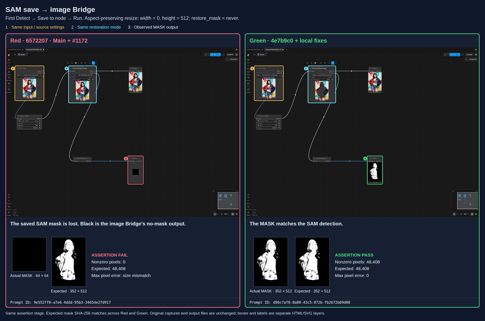
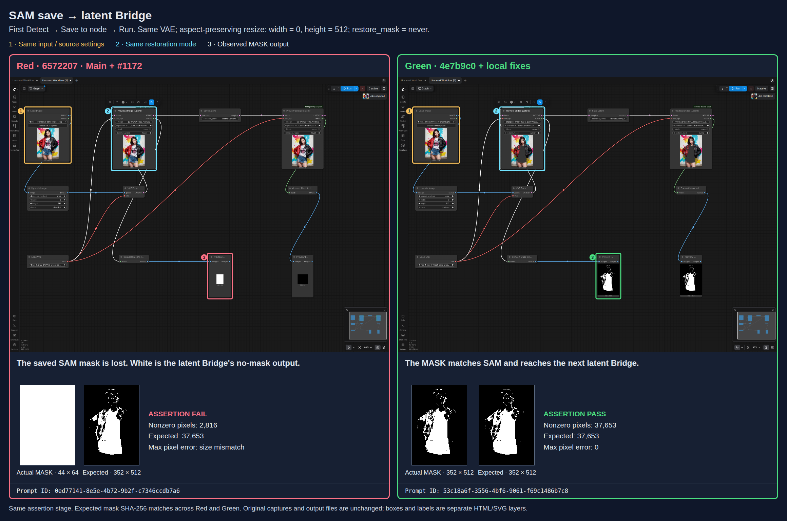
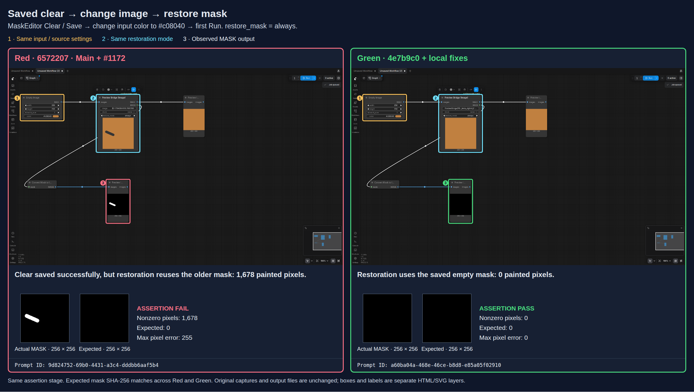
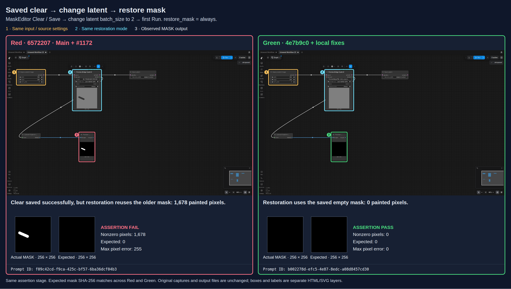
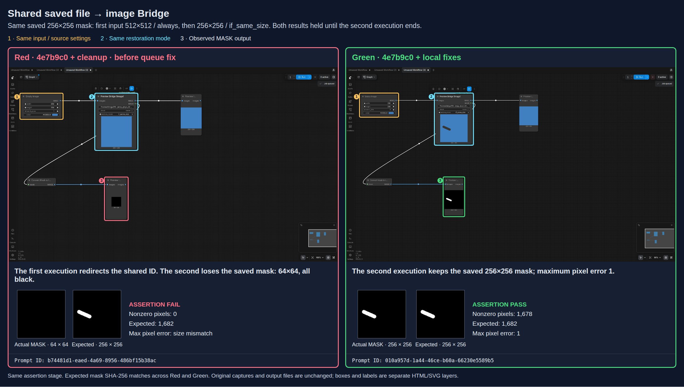
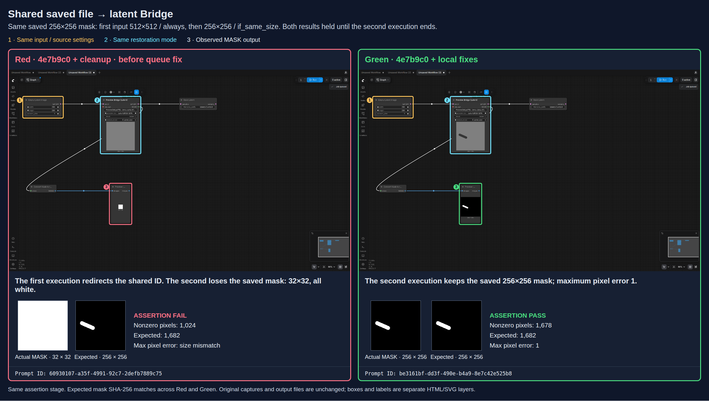
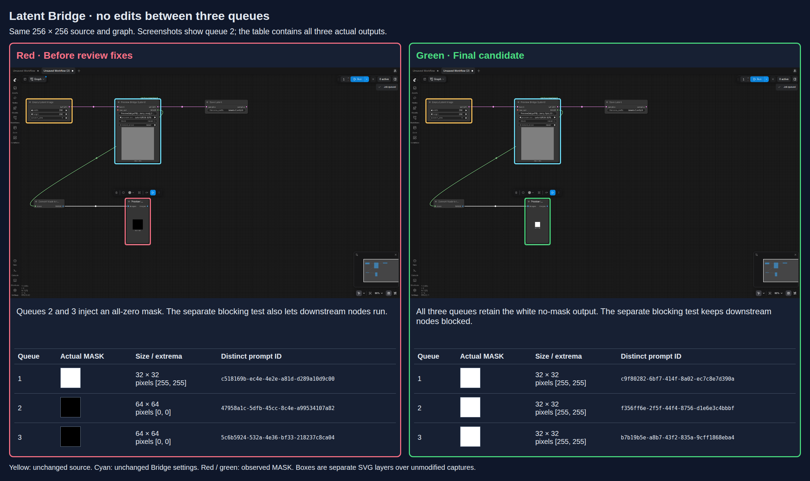
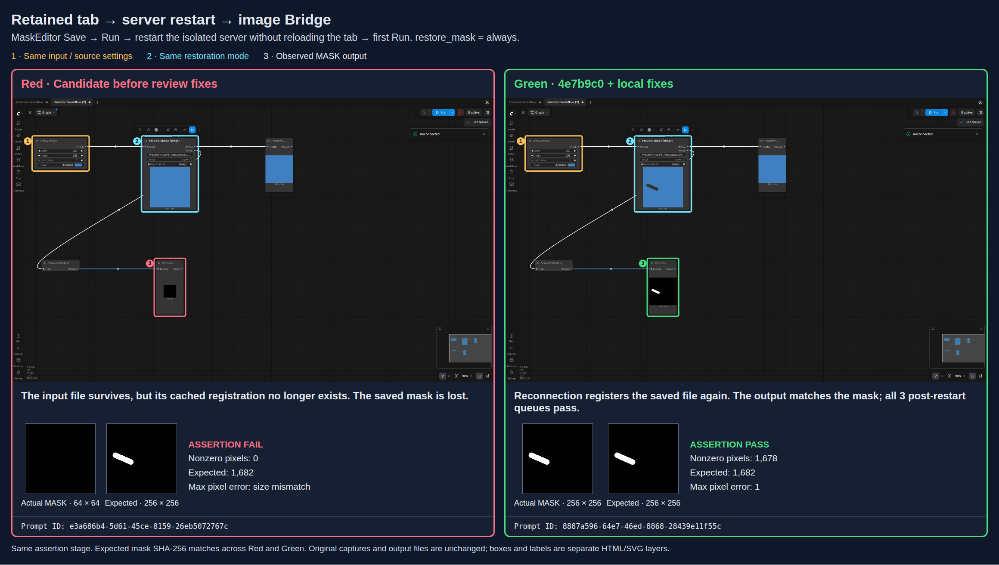
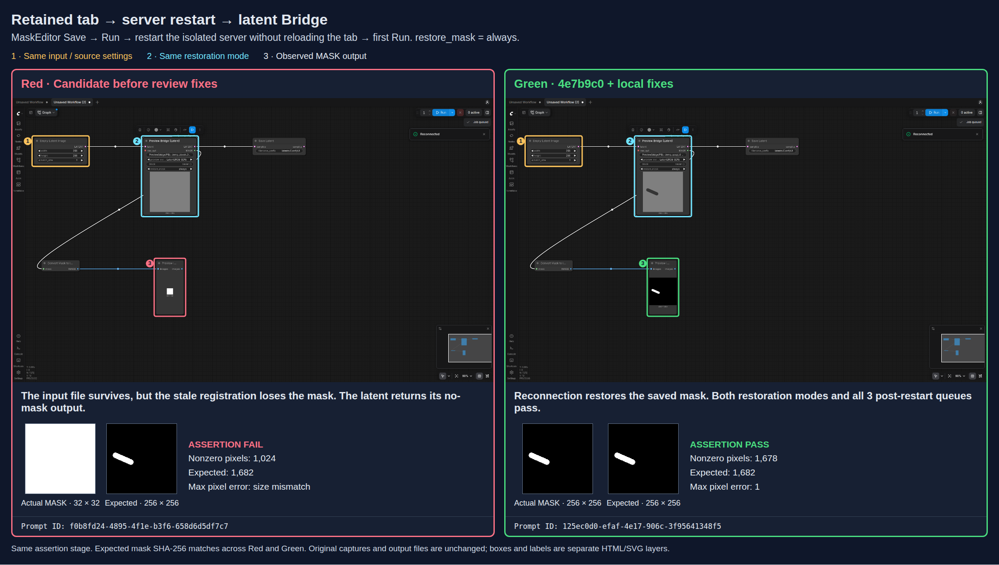

# Keep Preview Bridge edits synchronized after native widget compatibility changes

## Intent and scope

Follow up on #1172 for `PreviewBridge` and `PreviewBridgeLatent`. **Depends on #1172, which is still open.** This Draft PR targets `integration/pr1172-preview-bridge` so its diff contains only the follow-up commit. Merge #1172 into Main first, then rebase this follow-up onto updated Main and retarget the PR before merging it. Fix lost legacy SAM temp masks, stale editor images and restoration of an older mask after a cleared mask was successfully saved. Preserve the edit submitted by each queued prompt, the unedited latent state across repeated queues, and saved input masks after a server restart with the tab retained. Retain #1172's ImageReceiver protection for non-configurable widgets.

## Mask restoration and user impact

Preview Bridge lets users edit a mask on an image or latent preview. When an upstream input changes and the preview is refreshed, `restore_mask` decides whether to carry the saved mask onto that new input:

| Setting | Behavior on input refresh |
|---|---|
| `never` | Do not restore the previous mask. |
| `if_same_size` | Restore only when the saved mask's height and width match the new preview. |
| `always` | Restore even when dimensions differ; resize the mask when applying it to the preview. |

For example, changing a generation seed while keeping the same resolution lets `if_same_size` reuse the mask at the same coordinates. While the input remains unchanged, saving an edit still applies that mask with `never`. On a latent refresh, an incoming `noise_mask` takes precedence over restoration. Restoration runs before the `block` check.

Here, **Clear** means right-clicking either Bridge → **Open in MaskEditor** → **Clear** → **Save** in ComfyUI's mask editor. It clears the edited selection and saves that empty mask back to the node.

**The Clear operation was saved successfully. The bug occurred later, during restoration.** In the #1172 baseline captures, both nodes submitted the saved 256×256 file with an all-zero mask. After the upstream input changed, the restoration path rejected that empty mask and selected the cached mask from before Clear. The output therefore contained the old 1,678 painted pixels again.

This PR restores from the saved edit, including an explicitly cleared mask, before falling back to the cache. A saved clear therefore stays empty when restoration applies. The `never` / `if_same_size` / `always` conditions above still determine when restoration applies. The Clear evidence tests this restore-source selection with `always`; the SAM evidence separately tests delivery of a saved nonempty mask with `never`.

## Changes

- Register the native filename before prompt submission, preserving filename/subfolder/type metadata. Failed registration blocks submission and permits retry.
- Give registrations distinct IDs and match execution feedback before updating the filename, preserving newer edits when results arrive late. Keep each registration attached to its saved file; cache refreshed previews separately so queued prompts sharing that file cannot change each other's restore source.
- Restore the submitted edit's mask, including a successfully saved clear, before consulting older cached masks; propagate latent `noise_mask`. Preserve input samples and incoming mask precedence.
- Retain edits for identical recomputed single images; recomputed batches keep every frame. Clear incompatible caches on Bridge-type reuse. Distinguish an RGB preview without a mask from an explicitly saved clear.
- Re-register saved files after the frontend reconnects; ignore previous-connection feedback when updating the saved filename. Ordinary queues still reuse their registration.

## Evidence

Red is the local integration of Main + #1172 (`6572207`); Green captures are from `4e7b9c0` plus review fixes, recorded in `feedback-fixes/green-chrome/source.json`. They precede the equivalent branch cleanup verified below. Headless Chrome performs the same UI actions and assertions in separate runtimes. Each pair below uses the **same execution stage and byte-identical expected mask**. SAM uses real ViT-B detection; latent cases use the SD1.5 VAE. The 704×1024 source is resized with `width=0`, `height=512`, `area`, producing 352×512 without changing its aspect ratio. There is no diffusion sampling.

| Scenario / same comparison stage | Red · `6572207` | Green · `4e7b9c0` + local fixes |
|---|---|---|
| Image Bridge: first SAM Save → Run; `restore_mask=never` | Saved SAM mask lost; no-mask output (64×64, all-zero). Expected 352×512 with 48,408 nonzero pixels | 352×512, 48,408 nonzero pixels; maximum pixel error 0 |
| Latent Bridge: first SAM Save → Run; `restore_mask=never` | Saved SAM mask lost; no-mask output (44×64, all-one). Expected 352×512 with 37,653 nonzero pixels | 352×512, 37,653 nonzero pixels; maximum pixel error 0; next Bridge receives the mask |
| Image Bridge: MaskEditor Clear/Save → change color → first Run; `restore_mask=always` | Empty mask saved successfully; refresh restores the pre-Clear mask (1,678 painted pixels; maximum error 255) | Restores the saved empty mask: 0 nonzero pixels; maximum error 0 |
| Latent Bridge: MaskEditor Clear/Save → change batch size → first Run; `restore_mask=always` | Empty mask saved successfully; refresh restores the pre-Clear mask (1,678 painted pixels; maximum error 255) | Restores the saved empty mask: 0 nonzero pixels; maximum error 0 |

<details>
<summary>Red / Green captures — first SAM save, both Bridge types</summary>

Both sides show the first save, before a second edit or workflow reload. Box 1 identifies the common input; box 2 identifies the restoration mode; box 3 identifies the observed MASK. Actual output files and expected masks appear below the unmodified workflow captures.

Both Red cases lose the saved mask. The black Image Bridge output and white Latent Bridge output represent each node's no-mask state.





</details>

<details>
<summary>Red / Green captures — restoration uses the saved clear instead of the older mask</summary>

Both sides show the first execution after MaskEditor Clear/Save and the same source change. Saving succeeded; this comparison checks which mask restoration uses. Red selects the cached mask from before Clear. Green uses the saved empty mask.





Green repeats the cleared-mask queue three times for each Bridge. Distinct prompt IDs distinguish the executions; later queues may reuse cached output.

| Queue | Image Bridge prompt ID | Latent Bridge prompt ID | Nonzero pixels / max error, both |
|---|---|---|---|
| 1 | `a60ba04a-468e-46ce-b8d8-e85a05f02910` | `b002278d-efc5-4e87-8edc-a08d8457cd30` | 0 / 0 |
| 2 | `7ef4e586-ed4f-49a3-a59d-4ccf9c16253f` | `2de3c4dc-0730-4ed8-8183-15ec9c6449d7` | 0 / 0 |
| 3 | `1d470b09-9a76-461c-9d0a-952c540c51fa` | `109af680-a301-43c7-9943-b3f676503f9b` | 0 / 0 |

</details>

[Original captures and hashes](impact-pack-pr1172-followup-pr-assets/red-green/manifest.json) · [Red execution report](impact-pack-pr1172-followup-pr-assets/feedback-fixes/red-pr1172/browser.xml) · [Green execution report](impact-pack-pr1172-followup-pr-assets/feedback-fixes/green-chrome/browser.xml)

The 64-case Chrome/API run covers repeated Vue edits in `if_same_size`, SAM saves in all three restoration modes, registration failure/retry and the unchanged catalog of 198 nodes and 719 widgets. It also covers downstream mask propagation and latent resize/restoration. API/widget bindings are controlled in JavaScript tests; fault tests control registration failure, WebSocket delivery or the isolated server lifecycle.

Batch preservation is checked separately: 2/3 frames × three restoration modes retain every frame on both #1172 and Green. A control without the single-image guard (`642d877`) returns only one frame and fails all six assertions. [Failing batch assertions](impact-pack-pr1172-followup-pr-assets/review-batch-red.xml) · [Passing backend report](impact-pack-pr1172-followup-pr-assets/cleanup-review/backend.xml)

## Queued prompts sharing one saved image

Reusing a filename's registration within one connection is intentional. Previously, backend refresh redirected that shared registration to its output preview. A later prompt could then restore from the earlier execution's resized mask instead of the file it submitted. Registrations now remain attached to their saved files, while the existing per-node cache holds the refreshed preview for reuse.

The browser comparison saves a 256×256 mask, runs a 512×512 input with `always`, then a 256×256 input with `if_same_size`. It holds execution feedback until both runs finish, so both prompts submit the same registration. Executions remain sequential. Backend cases also cover `never` on the first refresh and a saved empty mask.

| Second execution | Before this fix · `4e7b9c0` + cleanup | Final candidate |
|---|---|---|
| Image Bridge | Original mask lost: 64×64, all-zero | 256×256 saved mask retained; maximum pixel error 1 |
| Latent Bridge | Original mask lost: 32×32, all-one | 256×256 saved mask retained; maximum pixel error 1 |
| Same-input reuse after refresh | Shared-reference tests fail before reaching this check | Returned images and actual preview-file RGB stay refreshed for both Bridge types. Latent samples remain unchanged. |

<details>
<summary>Red / Green captures and execution sequence — shared saved file</summary>

Unlike the four #1172 comparisons above, Red here is the follow-up candidate before the queue fix. Both sides show the second execution after releasing its result. Boxes identify the same input size, restoration mode and MASK output. Green uses the same assertion and expected mask bytes as Red.





| Green stage | Image Bridge prompt ID | Latent Bridge prompt ID | Observed MASK, both |
|---|---|---|---|
| 512×512 input, `always`; feedback held | `1b58e4bc-7b21-4074-a347-7914a50789bc` | `c41e55d7-2dd9-435c-9dda-3aea359e2581` | 256×256, 1,678 nonzero pixels |
| 256×256 input, `if_same_size`; same submitted ID | `010a957d-1a44-46ce-b60a-66230e5589b5` | `be3161bf-dd3f-490e-b4a9-8e7c42e525b8` | 256×256, 1,678 nonzero pixels |
| Native export/reload → Run | `e9c2526a-633f-428e-bbda-443c952e010b` | `c99da9d5-ad25-41d3-b379-ec5d6b584754` | 256×256, 1,678 nonzero pixels |

[Actual submitted references, outputs and trace hashes](impact-pack-pr1172-followup-pr-assets/shared-reference-sequence.json) · [Red report](impact-pack-pr1172-followup-pr-assets/feedback-fixes/red-shared/browser.xml) · [Green report](impact-pack-pr1172-followup-pr-assets/feedback-fixes/green-chrome/browser.xml)

</details>

## Unedited queues and server restart

An RGB latent preview has **no saved mask**. Reusing it must preserve the latent's absence of `noise_mask` and its white, latent-sized MASK output. This differs from a saved Clear, whose alpha channel explicitly encodes an all-zero mask. The shared loader now preserves that distinction; each Bridge applies its own no-mask behavior.

Registrations live in server memory. A retained tab now invalidates its registration cache on reconnection and registers the saved filename again. The restart tests preserve the actual MaskEditor input file, restart only the isolated ComfyUI process and leave the browser tab open. This does not make deleted temporary files recoverable.

| Scenario | Before the review fixes | Final candidate |
|---|---|---|
| Latent, no edits, three queues | Queue 1: 32×32 white; queues 2–3: 64×64 black and an unintended `noise_mask` | All three: 32×32 white; no `noise_mask`; source samples unchanged |
| Latent, no edits, `block=if_empty_mask` | Queue 1 blocked; queues 2–3 run downstream | All three remain blocked |
| Image control, no edits | Three 64×64 black outputs; blocking remains effective | Same behavior |
| Retained tab, server restart, `always` / `if_same_size` × both Bridges | Saved input file survives, but stale registration loses the mask: Image 64×64 black / Latent 32×32 white | Saved 256×256 mask retained through three post-restart queues in each of four cases; maximum pixel error 1 |

Backend cases additionally inspect `noise_mask` absence, unchanged input samples, and the distinction between no alpha, a saved clear and a full saved mask.

The unedited latent defect also exists in Main + #1172; the retained-tab regression came from this follow-up's registration cache. These comparisons use the follow-up candidate **before the review fixes**, with the same tests as Green: six intended failures and two passing Image controls.

<details>
<summary>Red / Green captures — repeated queues and retained-tab restart</summary>

The repeated-queue panel includes all three actual MASK outputs and distinct prompt IDs. Boxes identify the unchanged input/settings and the differing output. The restart panels compare the first queue after the real restart; tests additionally repeat two more queues and check both restoration modes.







[Three-queue records and source hashes](impact-pack-pr1172-followup-pr-assets/red-green/requeue-manifest.json) · [Red execution report](impact-pack-pr1172-followup-pr-assets/feedback-fixes/red-chrome/browser.xml)

</details>

## Validation

Candidate: `a5350a6`, one follow-up commit above the separate local Main + #1172 integration (`45e5321`). After #1172 merges, rebase only this follow-up onto updated Main. Its tree is identical to the validated working copy. [Verified source snapshot and results](impact-pack-pr1172-followup-pr-assets/final-state.json). Environment: ComfyUI `61e524bd` (0.44.0), frontend 1.58.5, Chrome, Python 3.12, PyTorch 2.10.0+cu128 and Node 24.12.0. Each comparison imports its own checkout under an isolated ComfyUI base directory.

| Suite | Result |
|---|---:|
| All JavaScript unit tests, including 19 Bridge/ImageReceiver cases | 81 passed |
| Backend: Bridge, SAM masks, mask-to-SEGS and image-list batching | 200 passed, including 51 Bridge cases |
| Latest Chrome: native reload, unedited queues and deferred execution feedback | 12 passed; [report](impact-pack-pr1172-followup-pr-assets/cleanup-review/chrome/browser.xml) |
| Full Chrome/API before the equivalent branch cleanup | 64 passed; [report](impact-pack-pr1172-followup-pr-assets/feedback-fixes/green-chrome/browser.xml) |
| Unedited queues and real server restart | 6 intended failures + 2 passing controls → 8 passed |
| Shared-file regression before/after fix | Backend: 8 intended failures → 8 passed; Chrome: 2 intended failures → 2 passed |

Current checks have zero failures and zero skips. The same 200 backend cases pass before and after simplifying two legacy-file fallback branches; the latest 12 Chrome cases pass in 169 seconds. The preceding full 64-case run, including four real restarts, remains separately recorded. All Red/Green browser comparisons use the unchanged current E2E test file. Clear cases verify the saved file's empty mask before changing the input and checking restoration. Trusted catalog fixtures remain byte-identical to the baseline.

Backend coverage includes native and legacy references, saved versus missing files, no-alpha versus saved-clear masks, cache-policy transitions and queued edits. [Review findings and validation boundaries](impact-pack-pr1172-followup-pr-assets/REREVIEW.md).

Reproduce from the branch using the ComfyUI Python environment and the isolated server setup in `docs/E2E_TEST_STRATEGY.md`:

```bash
node --experimental-vm-modules --test tests/*.test.mjs
IMPACT_COMFY_ROOT=/path/to/ComfyUI PYTHONPATH=/path/to/ComfyUI:$PWD/modules python -m pytest \
  tests/test_preview_bridge_result.py \
  tests/test_sam_masks.py tests/test_mask_to_segs.py tests/test_image_list_batch.py -q
# Full browser suite; restart command must control only the isolated test server.
IMPACT_E2E_BASE_URL=http://127.0.0.1:18176 \
IMPACT_E2E_SAM_IMAGE=/path/to/subject.png \
IMPACT_E2E_RESTART_COMMAND="/path/to/restart-isolated-server" \
python -m pytest tests/test_e2e_preview_bridge.py tests/test_e2e_legacy_sam.py \
  tests/test_e2e_widget_catalog.py tests/test_sam_api.py -v
```

Not validated: older frontend releases, GPU execution, diffusion sampling or recovery of deleted temporary files. Retained-tab restarts are verified for saved input files with `always` and `if_same_size`; `never` still deliberately discards a mask when the input refreshes. Legacy opaque IDs still require their server mapping and image file.

Published evidence includes the embedded comparisons, original captures and output masks, queue records, source manifests and test reports. Browser trace ZIPs, runtime checkouts and model files remain in the local archive.
