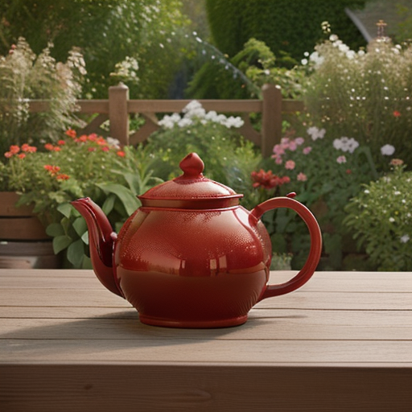
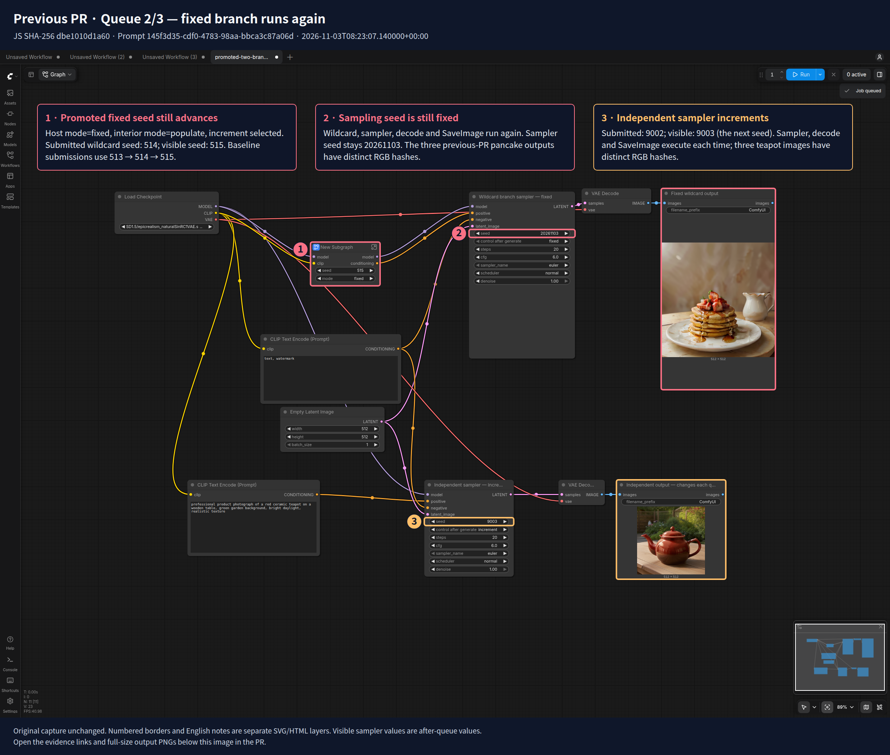
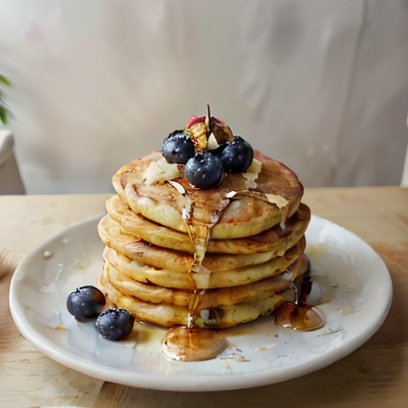
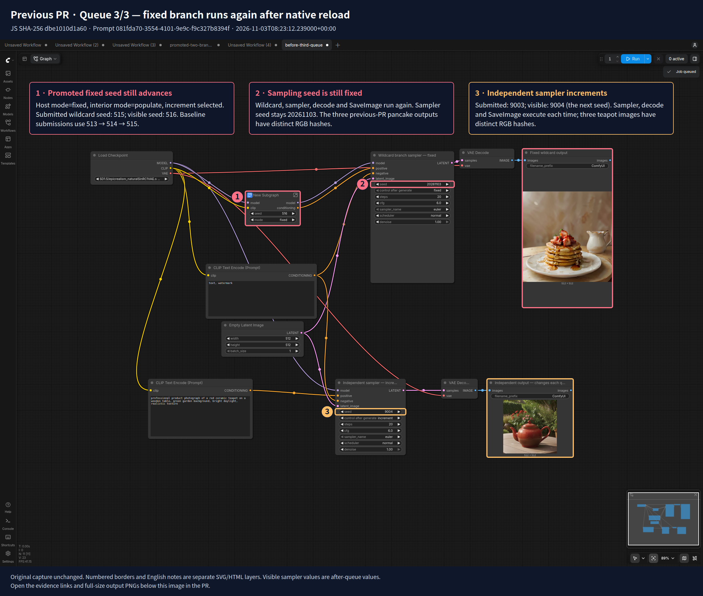

# Keep fixed wildcard nodes cached with automatic seed control

Issue [#513](https://github.com/ltdrdata/ComfyUI-Impact-Pack/issues/513): `mode=fixed` still reruns wildcard nodes when automatic seed control changes their input. Pause those changes for both wildcard nodes, including promoted seeds in native nested subgraphs and active/linked populated text.

- Reuse core hooks, arithmetic and native widget objects. Preserve widget names, order, saved values and selected policies.
- Resolve effective host modes; restore shared policies before declining an unavailable binding. Restore before serialization/on error, and redraw restored after-queue controls before paint.

**User impact:** fixed + randomize also freezes choices in `populated_text`. Use populate for automatic variation. Manual/upstream edits still invalidate caches. Reload the browser after updating.

**Boundaries:** independent Inspire GlobalSeed remains external. Native promoted populate/before projection bookkeeping remains a [separate frontend issue draft](impact-pack-issue513-frontend-projection-identity-issue-draft.md). Partially addresses #513.

**Verification:** one commit `6d1a488` on `Main` `56a34b9`; [validated source/capture mapping](impact-pack-issue513-pr-assets/audit-fixes-20261103/commit.json). Node 24.12.0 **60 tests × 10 runs**, Python **373 passed**; Chrome cache/tutorial **62**, catalog **14 / 198 records**, promoted **24 classic + 24 LRU** scenarios verified. Promoted cases contrast host=fixed/interior=populate, with three fixed queues, native reload and manual invalidation. Focused mode cases were rerun after replacing popup interaction; original failures remain in the [exact results](impact-pack-issue513-pr-assets/audit-fixes-20261103/summary.json) and [review notes](impact-pack-issue513-pr-assets/audit-fixes-20261103/review-notes.md).

```bash
# Node 24
node --experimental-vm-modules --test tests/*.test.mjs
python -m pytest tests/test_wildcard_cache_artifacts.py -v
python -m pytest tests/test_e2e_wildcard_cache.py tests/test_e2e_wildcard_tutorials.py -k 'not inference' -v
```

[Browser setup](https://github.com/ltdrdata/ComfyUI-Impact-Pack/blob/6d1a48803313c0b38193366bcef8f31dd552e70d/docs/E2E_TEST_STRATEGY.md). RGR: unit **4 failures → 31 passes → same 4 failures**; artifact **2 failures → 3 passes → same 2 failures**; ignoring host mode in Chrome after timing **2 failures → 2 passes → same 2 failures**.

Fresh SD1.5/foodphoto renders, **512×512**, three queues per revision; native reload before queue 3. Previous-PR baseline `b1ee82d` advances promoted seeds **513/514/515**; patched stays **513** and caches queues 2–3. The independent sampler advances **9001/9002/9003**, producing three distinct images. Corresponding independent outputs and initial fixed outputs match exactly. [Workflow](impact-pack-issue513-pr-assets/audit-fixes-20261103/sampling/promoted-two-branch-workflow.json) · [Cache/pixel proof](impact-pack-issue513-pr-assets/audit-fixes-20261103/sampling/comparison.json).

Green marks the patched fixed branch, red the prior failure, orange the independent sampler. Previews open full-size PNGs; evidence links are outside images.

<details>
<summary>Queue 1/3 — initial render</summary>

**Previous PR**

[](impact-pack-issue513-pr-assets/audit-fixes-20261103/sampling/overlays/baseline-queue-1.png)

[Original](impact-pack-issue513-pr-assets/audit-fixes-20261103/sampling/baseline/queue-1-workflow.png) · [History](impact-pack-issue513-pr-assets/audit-fixes-20261103/sampling/baseline/queue-1-history.json) · [Widget values](impact-pack-issue513-pr-assets/audit-fixes-20261103/sampling/baseline/queue-1-widget-state.json)

| Fixed output | Independent output |
| --- | --- |
| [](impact-pack-issue513-pr-assets/audit-fixes-20261103/sampling/baseline/queue-1-fixed-output.png) | [](impact-pack-issue513-pr-assets/audit-fixes-20261103/sampling/baseline/queue-1-independent-output.png) |

**Patched**

[](impact-pack-issue513-pr-assets/audit-fixes-20261103/sampling/overlays/candidate-queue-1.png)

[Original](impact-pack-issue513-pr-assets/audit-fixes-20261103/sampling/candidate/queue-1-workflow.png) · [History](impact-pack-issue513-pr-assets/audit-fixes-20261103/sampling/candidate/queue-1-history.json) · [Widget values](impact-pack-issue513-pr-assets/audit-fixes-20261103/sampling/candidate/queue-1-widget-state.json)

| Fixed output | Independent output |
| --- | --- |
| [](impact-pack-issue513-pr-assets/audit-fixes-20261103/sampling/candidate/queue-1-fixed-output.png) | [](impact-pack-issue513-pr-assets/audit-fixes-20261103/sampling/candidate/queue-1-independent-output.png) |

</details>

<details>
<summary>Queue 2/3 — fixed branch cached</summary>

**Previous PR**

[](impact-pack-issue513-pr-assets/audit-fixes-20261103/sampling/overlays/baseline-queue-2.png)

[Original](impact-pack-issue513-pr-assets/audit-fixes-20261103/sampling/baseline/queue-2-workflow.png) · [History](impact-pack-issue513-pr-assets/audit-fixes-20261103/sampling/baseline/queue-2-history.json) · [Widget values](impact-pack-issue513-pr-assets/audit-fixes-20261103/sampling/baseline/queue-2-widget-state.json)

| Fixed output | Independent output |
| --- | --- |
| [](impact-pack-issue513-pr-assets/audit-fixes-20261103/sampling/baseline/queue-2-fixed-output.png) | [](impact-pack-issue513-pr-assets/audit-fixes-20261103/sampling/baseline/queue-2-independent-output.png) |

**Patched**

[](impact-pack-issue513-pr-assets/audit-fixes-20261103/sampling/overlays/candidate-queue-2.png)

[Original](impact-pack-issue513-pr-assets/audit-fixes-20261103/sampling/candidate/queue-2-workflow.png) · [History](impact-pack-issue513-pr-assets/audit-fixes-20261103/sampling/candidate/queue-2-history.json) · [Widget values](impact-pack-issue513-pr-assets/audit-fixes-20261103/sampling/candidate/queue-2-widget-state.json)

| Fixed output | Independent output |
| --- | --- |
| [](impact-pack-issue513-pr-assets/audit-fixes-20261103/sampling/candidate/queue-2-fixed-output.png) | [](impact-pack-issue513-pr-assets/audit-fixes-20261103/sampling/candidate/queue-2-independent-output.png) |

</details>

<details>
<summary>Queue 3/3 — after native reload</summary>

**Previous PR**

[](impact-pack-issue513-pr-assets/audit-fixes-20261103/sampling/overlays/baseline-queue-3.png)

[Original](impact-pack-issue513-pr-assets/audit-fixes-20261103/sampling/baseline/queue-3-workflow.png) · [History](impact-pack-issue513-pr-assets/audit-fixes-20261103/sampling/baseline/queue-3-history.json) · [Widget values](impact-pack-issue513-pr-assets/audit-fixes-20261103/sampling/baseline/queue-3-widget-state.json)

| Fixed output | Independent output |
| --- | --- |
| [](impact-pack-issue513-pr-assets/audit-fixes-20261103/sampling/baseline/queue-3-fixed-output.png) | [](impact-pack-issue513-pr-assets/audit-fixes-20261103/sampling/baseline/queue-3-independent-output.png) |

**Patched**

[](impact-pack-issue513-pr-assets/audit-fixes-20261103/sampling/overlays/candidate-queue-3.png)

[Original](impact-pack-issue513-pr-assets/audit-fixes-20261103/sampling/candidate/queue-3-workflow.png) · [History](impact-pack-issue513-pr-assets/audit-fixes-20261103/sampling/candidate/queue-3-history.json) · [Widget values](impact-pack-issue513-pr-assets/audit-fixes-20261103/sampling/candidate/queue-3-widget-state.json)

| Fixed output | Independent output |
| --- | --- |
| [](impact-pack-issue513-pr-assets/audit-fixes-20261103/sampling/candidate/queue-3-fixed-output.png) | [](impact-pack-issue513-pr-assets/audit-fixes-20261103/sampling/candidate/queue-3-independent-output.png) |

</details>
