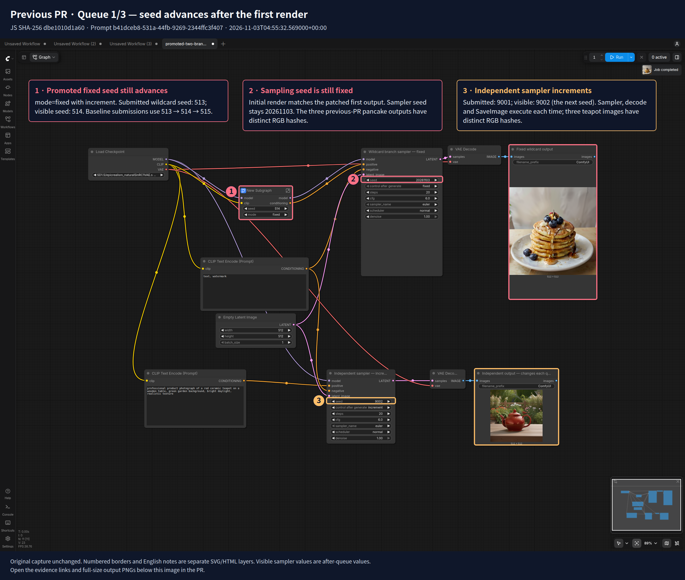
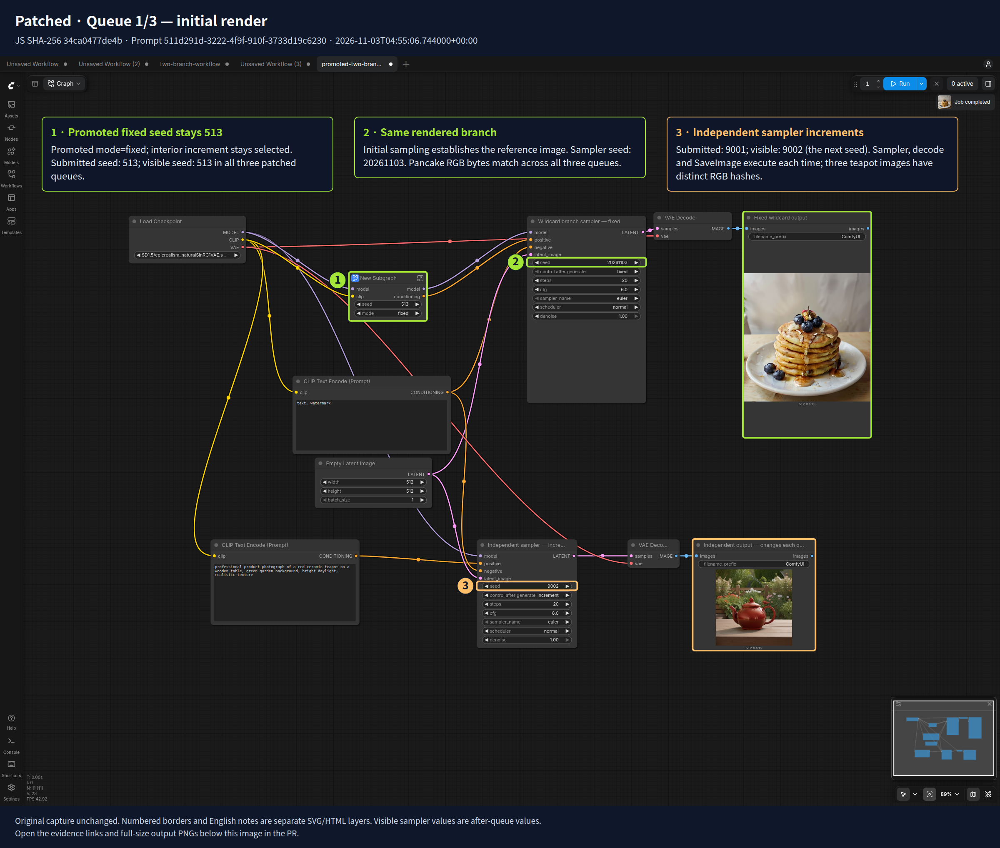
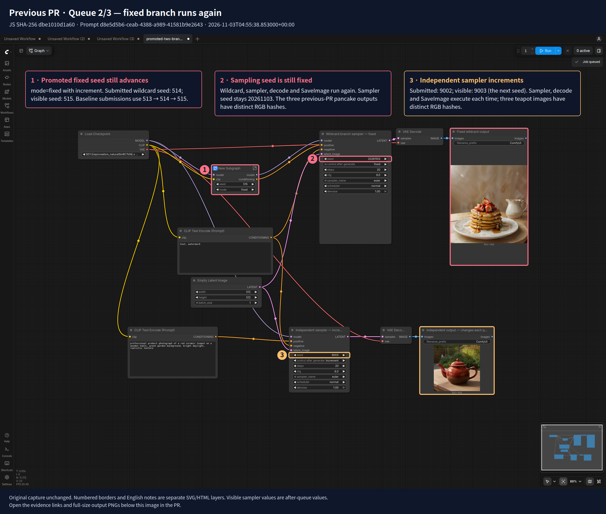
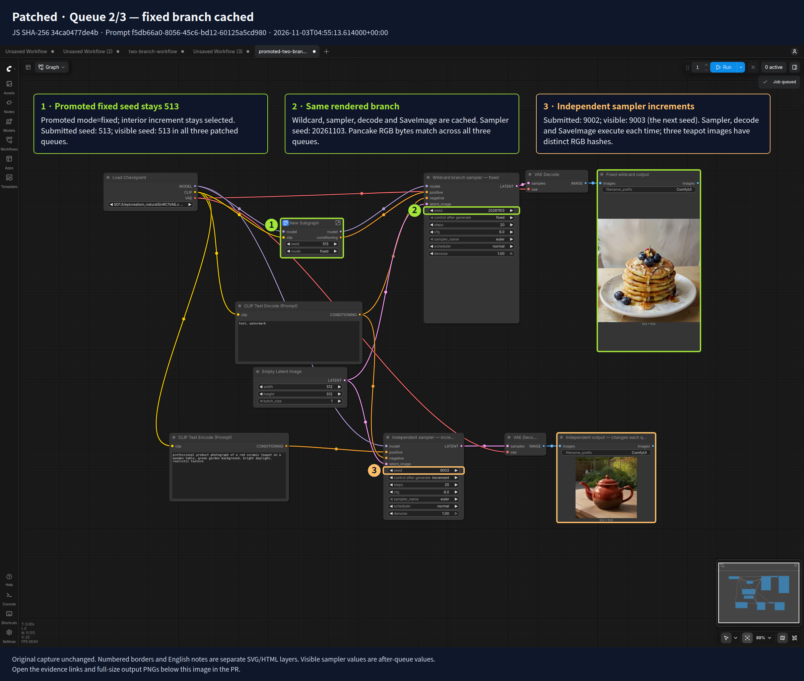
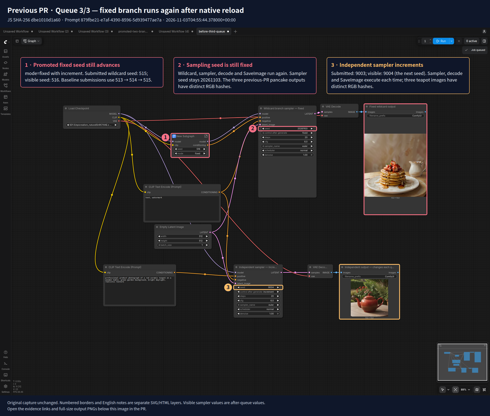
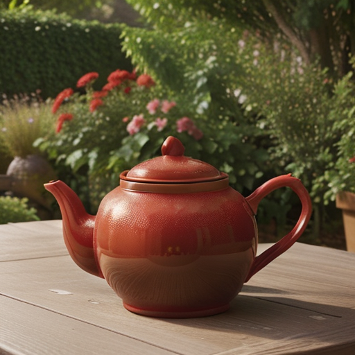

# Keep fixed wildcard nodes cached with automatic seed control

Issue [#513](https://github.com/ltdrdata/ComfyUI-Impact-Pack/issues/513): fixed wildcard nodes still rerun when automatic seed control changes their input. This pauses automatic seed changes for both wildcard nodes, including promoted seeds in nested native subgraphs and linked/active populated text.

- Delegate to core hooks and seed arithmetic, preserving queue timing and the selected policy. Restore temporary policies before serialization and on error.
- Resolve promoted seed/mode bindings per instance; preserve core first-queue bookkeeping when native widget projections are recreated.
- Preserve widget names, order and saved values. Manual edits and upstream changes still invalidate the cache.

**User impact:** fixed + randomize now also freezes choices in `populated_text`. Use populate with the expression in `wildcard_text` for automatic variation. Tooltips explain this change. Reload the browser after updating.

**Remaining limitation:** Inspire GlobalSeed is an independent upstream controller and can still change fixed inputs. This partially addresses #513.

**Validation:** rebased onto `Main` `56a34b9`; one PR commit `3452e43`. Python **370 passed**, Node **54 passed**; Chrome cache/tutorial **62**, catalog **14** (198 records), connection-type **30**, promoted-seed **24 classic + 24 LRU** scenarios. Promoted cases run ten unchanged fixed queues, then check manual edits, native restoration and submitted seeds on populate resumption. [Exact runs and boundaries](impact-pack-issue513-pr-assets/subgraph-fix-20261103/summary.json) · [Review notes](impact-pack-issue513-pr-assets/subgraph-fix-20261103/review-notes.md).

```bash
node --experimental-vm-modules --test tests/*.test.mjs
python -m pytest tests/test_e2e_wildcard_cache.py tests/test_e2e_wildcard_tutorials.py -k 'not inference' -v
python -m pytest tests/test_e2e_widget_catalog.py tests/test_e2e_connection_types.py -v
```

Browser commands require isolated configured servers; [setup](https://github.com/ltdrdata/ComfyUI-Impact-Pack/blob/3452e437c982c7578cc4dd4a04ff748eb4484df6/docs/E2E_TEST_STRATEGY.md). RGR: unit **8 fail → 25 pass → same 8 fail**; browser **4 fail → 4 pass → same 4 fail**. Earlier broad model/SAM checks remain [historical evidence](impact-pack-issue513-pr-assets/full-regression-20261103/summary.json).

Three fresh rendered queues per revision, SD1.5/foodphoto, 512×512. Baseline is the previous PR rebased onto current Main: promoted seeds advance **513/514/515**. Patched seeds stay **513**, with cache hits on queues 2–3. The independent sampler advances **9001/9002/9003** and produces three distinct images in both revisions. Corresponding independent outputs and initial fixed outputs match exactly. Queue 3 follows native reload. [Workflow and provenance](impact-pack-issue513-pr-assets/subgraph-fix-20261103/sampling/README.md) · [Cache/pixel comparison](impact-pack-issue513-pr-assets/subgraph-fix-20261103/sampling/comparison.json).

Green = patched fixed branch; red = previous-PR failure; orange = independent sampler. Click any preview for full size; evidence links below are clickable.

<details>
<summary>Queue 1/3 — initial render</summary>

**Previous PR**

[](impact-pack-issue513-pr-assets/subgraph-fix-20261103/sampling/overlays/baseline-queue-1.png)

[Original capture](impact-pack-issue513-pr-assets/subgraph-fix-20261103/sampling/baseline/queue-1-workflow.png) · [History](impact-pack-issue513-pr-assets/subgraph-fix-20261103/sampling/baseline/queue-1-history.json) · [Widget values](impact-pack-issue513-pr-assets/subgraph-fix-20261103/sampling/baseline/queue-1-widget-state.json)

| Fixed output | Independent output |
| --- | --- |
| [](impact-pack-issue513-pr-assets/subgraph-fix-20261103/sampling/baseline/queue-1-fixed-output.png) | [](impact-pack-issue513-pr-assets/subgraph-fix-20261103/sampling/baseline/queue-1-independent-output.png) |

**Patched**

[](impact-pack-issue513-pr-assets/subgraph-fix-20261103/sampling/overlays/candidate-queue-1.png)

[Original capture](impact-pack-issue513-pr-assets/subgraph-fix-20261103/sampling/candidate/queue-1-workflow.png) · [History](impact-pack-issue513-pr-assets/subgraph-fix-20261103/sampling/candidate/queue-1-history.json) · [Widget values](impact-pack-issue513-pr-assets/subgraph-fix-20261103/sampling/candidate/queue-1-widget-state.json)

| Fixed output | Independent output |
| --- | --- |
| [](impact-pack-issue513-pr-assets/subgraph-fix-20261103/sampling/candidate/queue-1-fixed-output.png) | [](impact-pack-issue513-pr-assets/subgraph-fix-20261103/sampling/candidate/queue-1-independent-output.png) |

</details>

<details>
<summary>Queue 2/3 — cached fixed branch</summary>

**Previous PR**

[](impact-pack-issue513-pr-assets/subgraph-fix-20261103/sampling/overlays/baseline-queue-2.png)

[Original capture](impact-pack-issue513-pr-assets/subgraph-fix-20261103/sampling/baseline/queue-2-workflow.png) · [History](impact-pack-issue513-pr-assets/subgraph-fix-20261103/sampling/baseline/queue-2-history.json) · [Widget values](impact-pack-issue513-pr-assets/subgraph-fix-20261103/sampling/baseline/queue-2-widget-state.json)

| Fixed output | Independent output |
| --- | --- |
| [](impact-pack-issue513-pr-assets/subgraph-fix-20261103/sampling/baseline/queue-2-fixed-output.png) | [](impact-pack-issue513-pr-assets/subgraph-fix-20261103/sampling/baseline/queue-2-independent-output.png) |

**Patched**

[](impact-pack-issue513-pr-assets/subgraph-fix-20261103/sampling/overlays/candidate-queue-2.png)

[Original capture](impact-pack-issue513-pr-assets/subgraph-fix-20261103/sampling/candidate/queue-2-workflow.png) · [History](impact-pack-issue513-pr-assets/subgraph-fix-20261103/sampling/candidate/queue-2-history.json) · [Widget values](impact-pack-issue513-pr-assets/subgraph-fix-20261103/sampling/candidate/queue-2-widget-state.json)

| Fixed output | Independent output |
| --- | --- |
| [](impact-pack-issue513-pr-assets/subgraph-fix-20261103/sampling/candidate/queue-2-fixed-output.png) | [](impact-pack-issue513-pr-assets/subgraph-fix-20261103/sampling/candidate/queue-2-independent-output.png) |

</details>

<details>
<summary>Queue 3/3 — after native reload</summary>

**Previous PR**

[](impact-pack-issue513-pr-assets/subgraph-fix-20261103/sampling/overlays/baseline-queue-3.png)

[Original capture](impact-pack-issue513-pr-assets/subgraph-fix-20261103/sampling/baseline/queue-3-workflow.png) · [History](impact-pack-issue513-pr-assets/subgraph-fix-20261103/sampling/baseline/queue-3-history.json) · [Widget values](impact-pack-issue513-pr-assets/subgraph-fix-20261103/sampling/baseline/queue-3-widget-state.json)

| Fixed output | Independent output |
| --- | --- |
| [](impact-pack-issue513-pr-assets/subgraph-fix-20261103/sampling/baseline/queue-3-fixed-output.png) | [](impact-pack-issue513-pr-assets/subgraph-fix-20261103/sampling/baseline/queue-3-independent-output.png) |

**Patched**

[](impact-pack-issue513-pr-assets/subgraph-fix-20261103/sampling/overlays/candidate-queue-3.png)

[Original capture](impact-pack-issue513-pr-assets/subgraph-fix-20261103/sampling/candidate/queue-3-workflow.png) · [History](impact-pack-issue513-pr-assets/subgraph-fix-20261103/sampling/candidate/queue-3-history.json) · [Widget values](impact-pack-issue513-pr-assets/subgraph-fix-20261103/sampling/candidate/queue-3-widget-state.json)

| Fixed output | Independent output |
| --- | --- |
| [](impact-pack-issue513-pr-assets/subgraph-fix-20261103/sampling/candidate/queue-3-fixed-output.png) | [](impact-pack-issue513-pr-assets/subgraph-fix-20261103/sampling/candidate/queue-3-independent-output.png) |

</details>
