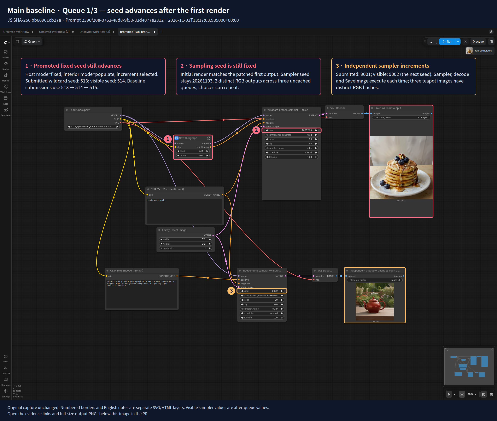
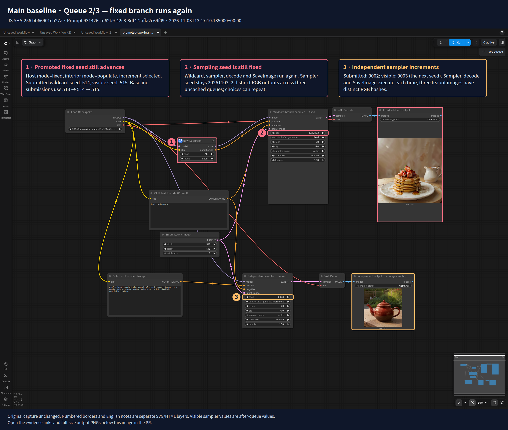
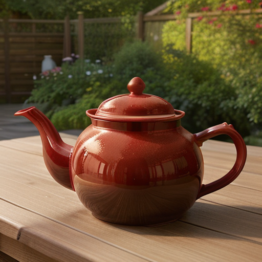
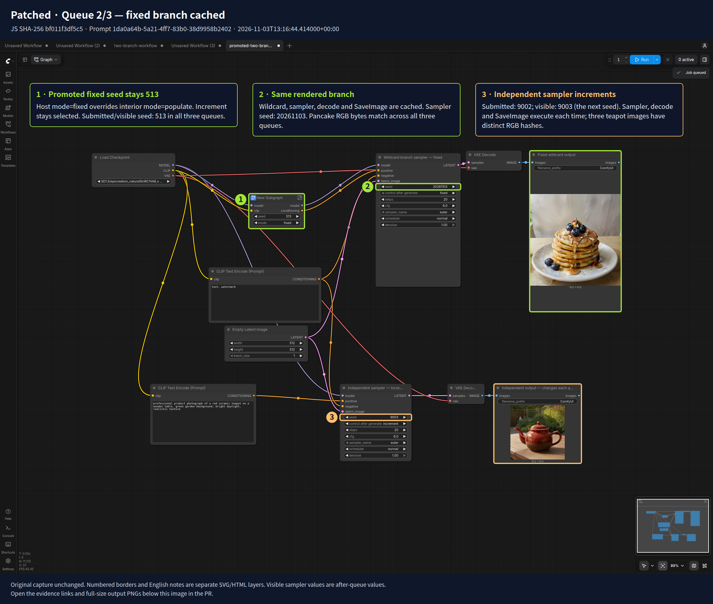

# Keep fixed wildcard nodes cached with automatic seed control

Issue [#513](https://github.com/ltdrdata/ComfyUI-Impact-Pack/issues/513): automatic seed control reruns wildcard nodes even in `mode=fixed`. Pause it for both wildcard nodes, including promoted/nested seeds and active or linked populated text.

- Reuse core hooks, arithmetic and native widget objects; preserve widget names, order, saved values and selected policies.
- Resolve host modes, restore shared policies before serialization/on error, and handle optional binding failures at one adapter boundary while preserving native errors.

**User impact:** fixed + randomize also freezes choices in `populated_text`; use populate for automatic variation. Manual and upstream inputs retain the backend cache semantics; constant text may reuse cached output. Reload the browser after updating.

**Boundaries:** independent Inspire GlobalSeed remains external. Promoted populate/before projection bookkeeping remains a [separate frontend issue draft](impact-pack-issue513-frontend-projection-identity-issue-draft.md). Partially addresses #513.

**Verification:** one commit `9cd74e5` on latest Main `46fd549`: Node **62**, Python **379**, Chrome **297 passed + 2 pre-existing Main Bypass xfail** (299 scenarios), plus five real validation/tensor scripts. Native workflow checks preserve both Main's multi-node/named values and promoted seed controls. [Rebase report](impact-pack-issue513-pr-assets/rebase-main-46fd549-20261103/report.md) · [Exact results](impact-pack-issue513-pr-assets/rebase-main-46fd549-20261103/summary.json) · [Source/capture mapping](impact-pack-issue513-pr-assets/rebase-main-46fd549-20261103/commit.json). The [prior full regression](impact-pack-issue513-pr-assets/full-regression-057abbe-20261103/report.md) is historical (`057abbe` / `56a34b9`); its six legacy failures are not current-base claims.

```bash
# Node runtime: tests/README.md#node-unit-tests
node --experimental-vm-modules --test tests/*.test.mjs
python -m pytest tests/test_wildcard_cache_artifacts.py -v
python -m pytest tests/test_e2e_wildcard_cache.py tests/test_e2e_wildcard_controls.py tests/test_e2e_wildcard_tutorials.py -k 'not inference' -v
```

[Browser setup](https://github.com/ltdrdata/ComfyUI-Impact-Pack/blob/9cd74e5134cc441739c193e7a5ae6902ab5edb18/docs/E2E_TEST_STRATEGY.md).

Fresh SD1.5/foodphoto **512×512** renders, three queues per revision with native reload before queue 3. Main baseline `46fd549` advances promoted seeds **513/514/515**; patched stays **513** and caches queues 2–3. Independent sampler **9001/9002/9003** produces three distinct outputs; corresponding independent outputs and initial fixed outputs match exactly. [Workflow](impact-pack-issue513-pr-assets/rebase-main-46fd549-20261103/sampling/promoted-two-branch-workflow.json) · [Cache/pixel proof](impact-pack-issue513-pr-assets/rebase-main-46fd549-20261103/sampling/comparison.json).

Green marks the patched fixed branch, red the prior failure, orange the independent sampler. Previews open full-size PNGs; evidence links are outside images.

<details>
<summary>Queue 1/3 — initial render</summary>

**Main baseline**

[](impact-pack-issue513-pr-assets/rebase-main-46fd549-20261103/sampling/overlays/baseline-queue-1.png)

[Original](impact-pack-issue513-pr-assets/rebase-main-46fd549-20261103/sampling/baseline/queue-1-workflow.png) · [History](impact-pack-issue513-pr-assets/rebase-main-46fd549-20261103/sampling/baseline/queue-1-history.json) · [Widget values](impact-pack-issue513-pr-assets/rebase-main-46fd549-20261103/sampling/baseline/queue-1-widget-state.json)

| Fixed output | Independent output |
| --- | --- |
| [](impact-pack-issue513-pr-assets/rebase-main-46fd549-20261103/sampling/baseline/queue-1-fixed-output.png) | [](impact-pack-issue513-pr-assets/rebase-main-46fd549-20261103/sampling/baseline/queue-1-independent-output.png) |

**Patched**

[](impact-pack-issue513-pr-assets/rebase-main-46fd549-20261103/sampling/overlays/candidate-queue-1.png)

[Original](impact-pack-issue513-pr-assets/rebase-main-46fd549-20261103/sampling/candidate/queue-1-workflow.png) · [History](impact-pack-issue513-pr-assets/rebase-main-46fd549-20261103/sampling/candidate/queue-1-history.json) · [Widget values](impact-pack-issue513-pr-assets/rebase-main-46fd549-20261103/sampling/candidate/queue-1-widget-state.json)

| Fixed output | Independent output |
| --- | --- |
| [](impact-pack-issue513-pr-assets/rebase-main-46fd549-20261103/sampling/candidate/queue-1-fixed-output.png) | [](impact-pack-issue513-pr-assets/rebase-main-46fd549-20261103/sampling/candidate/queue-1-independent-output.png) |

</details>

<details>
<summary>Queue 2/3 — fixed branch cached</summary>

**Main baseline**

[](impact-pack-issue513-pr-assets/rebase-main-46fd549-20261103/sampling/overlays/baseline-queue-2.png)

[Original](impact-pack-issue513-pr-assets/rebase-main-46fd549-20261103/sampling/baseline/queue-2-workflow.png) · [History](impact-pack-issue513-pr-assets/rebase-main-46fd549-20261103/sampling/baseline/queue-2-history.json) · [Widget values](impact-pack-issue513-pr-assets/rebase-main-46fd549-20261103/sampling/baseline/queue-2-widget-state.json)

| Fixed output | Independent output |
| --- | --- |
| [](impact-pack-issue513-pr-assets/rebase-main-46fd549-20261103/sampling/baseline/queue-2-fixed-output.png) | [](impact-pack-issue513-pr-assets/rebase-main-46fd549-20261103/sampling/baseline/queue-2-independent-output.png) |

**Patched**

[](impact-pack-issue513-pr-assets/rebase-main-46fd549-20261103/sampling/overlays/candidate-queue-2.png)

[Original](impact-pack-issue513-pr-assets/rebase-main-46fd549-20261103/sampling/candidate/queue-2-workflow.png) · [History](impact-pack-issue513-pr-assets/rebase-main-46fd549-20261103/sampling/candidate/queue-2-history.json) · [Widget values](impact-pack-issue513-pr-assets/rebase-main-46fd549-20261103/sampling/candidate/queue-2-widget-state.json)

| Fixed output | Independent output |
| --- | --- |
| [](impact-pack-issue513-pr-assets/rebase-main-46fd549-20261103/sampling/candidate/queue-2-fixed-output.png) | [](impact-pack-issue513-pr-assets/rebase-main-46fd549-20261103/sampling/candidate/queue-2-independent-output.png) |

</details>

<details>
<summary>Queue 3/3 — after native reload</summary>

**Main baseline**

[](impact-pack-issue513-pr-assets/rebase-main-46fd549-20261103/sampling/overlays/baseline-queue-3.png)

[Original](impact-pack-issue513-pr-assets/rebase-main-46fd549-20261103/sampling/baseline/queue-3-workflow.png) · [History](impact-pack-issue513-pr-assets/rebase-main-46fd549-20261103/sampling/baseline/queue-3-history.json) · [Widget values](impact-pack-issue513-pr-assets/rebase-main-46fd549-20261103/sampling/baseline/queue-3-widget-state.json)

| Fixed output | Independent output |
| --- | --- |
| [](impact-pack-issue513-pr-assets/rebase-main-46fd549-20261103/sampling/baseline/queue-3-fixed-output.png) | [](impact-pack-issue513-pr-assets/rebase-main-46fd549-20261103/sampling/baseline/queue-3-independent-output.png) |

**Patched**

[](impact-pack-issue513-pr-assets/rebase-main-46fd549-20261103/sampling/overlays/candidate-queue-3.png)

[Original](impact-pack-issue513-pr-assets/rebase-main-46fd549-20261103/sampling/candidate/queue-3-workflow.png) · [History](impact-pack-issue513-pr-assets/rebase-main-46fd549-20261103/sampling/candidate/queue-3-history.json) · [Widget values](impact-pack-issue513-pr-assets/rebase-main-46fd549-20261103/sampling/candidate/queue-3-widget-state.json)

| Fixed output | Independent output |
| --- | --- |
| [](impact-pack-issue513-pr-assets/rebase-main-46fd549-20261103/sampling/candidate/queue-3-fixed-output.png) | [](impact-pack-issue513-pr-assets/rebase-main-46fd549-20261103/sampling/candidate/queue-3-independent-output.png) |

</details>
