# Three-queue screenshots and actual outputs

Expand a queue to compare baseline and patched captures. Each block contains
clickable links to the original screenshot, execution history and widget state,
plus the actual 512 × 512 pancake and teapot output PNGs. Click an image to open it
at full size. Evidence links are outside the raster overlay.

Green identifies the patched fixed branch; red identifies the baseline branch
that still reruns; orange identifies the independent incrementing sampler.
The recorded candidate `aaec21a` has identical production code to `4819ada`.
These are annotations of existing runs, with no additional inference.

[Renderer](render.py) · [Source hashes](manifest.json) · [Verification](review.json).

Queue 1/3 — initial render: baseline vs patched screenshots and actual output PNGs

**Baseline · Prompt `38a49aa2-678e-4db9-b819-274de7785050`**

[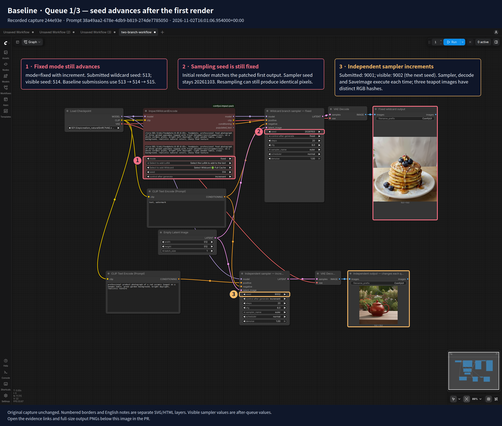](./baseline-queue-1.png)

[Original capture](../fixed-mode/seed-refresh/independent-sampler/baseline/queue-1-workflow.png) · [Queue history](../fixed-mode/seed-refresh/independent-sampler/baseline/queue-1-history.json) · [Visible widget values](../fixed-mode/seed-refresh/independent-sampler/baseline/queue-1-widget-state.json)

| Actual fixed wildcard output — pancakes | Actual independent sampler output — teapot |
| --- | --- |
| [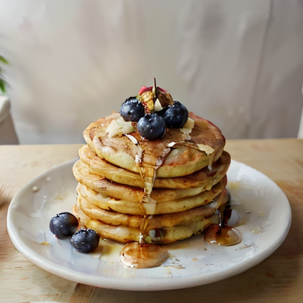](../fixed-mode/seed-refresh/independent-sampler/baseline/queue-1-fixed-output.png) | [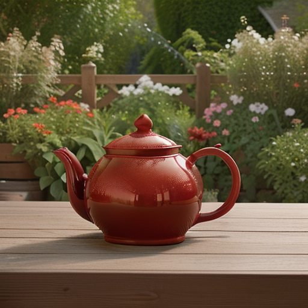](../fixed-mode/seed-refresh/independent-sampler/baseline/queue-1-independent-output.png) |

[Open full-size pancake PNG](../fixed-mode/seed-refresh/independent-sampler/baseline/queue-1-fixed-output.png) · [Open full-size teapot PNG](../fixed-mode/seed-refresh/independent-sampler/baseline/queue-1-independent-output.png)

**Patched · Prompt `692172a4-78fd-426b-8aac-0780cadf9838`**

[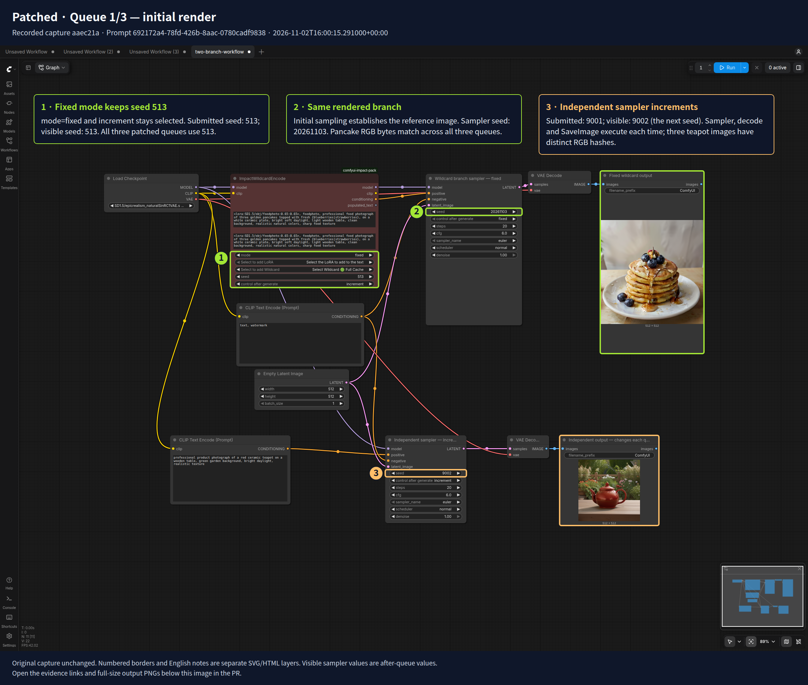](./candidate-queue-1.png)

[Original capture](../fixed-mode/seed-refresh/independent-sampler/candidate/queue-1-workflow.png) · [Queue history](../fixed-mode/seed-refresh/independent-sampler/candidate/queue-1-history.json) · [Visible widget values](../fixed-mode/seed-refresh/independent-sampler/candidate/queue-1-widget-state.json)

| Actual fixed wildcard output — pancakes | Actual independent sampler output — teapot |
| --- | --- |
|  |  |

[Open full-size pancake PNG](../fixed-mode/seed-refresh/independent-sampler/candidate/queue-1-fixed-output.png) · [Open full-size teapot PNG](../fixed-mode/seed-refresh/independent-sampler/candidate/queue-1-independent-output.png)

Queue 2/3 — repeat: baseline vs patched screenshots and actual output PNGs

**Baseline · Prompt `0f193ad2-5548-4825-a285-9bbdd62f0f19`**

[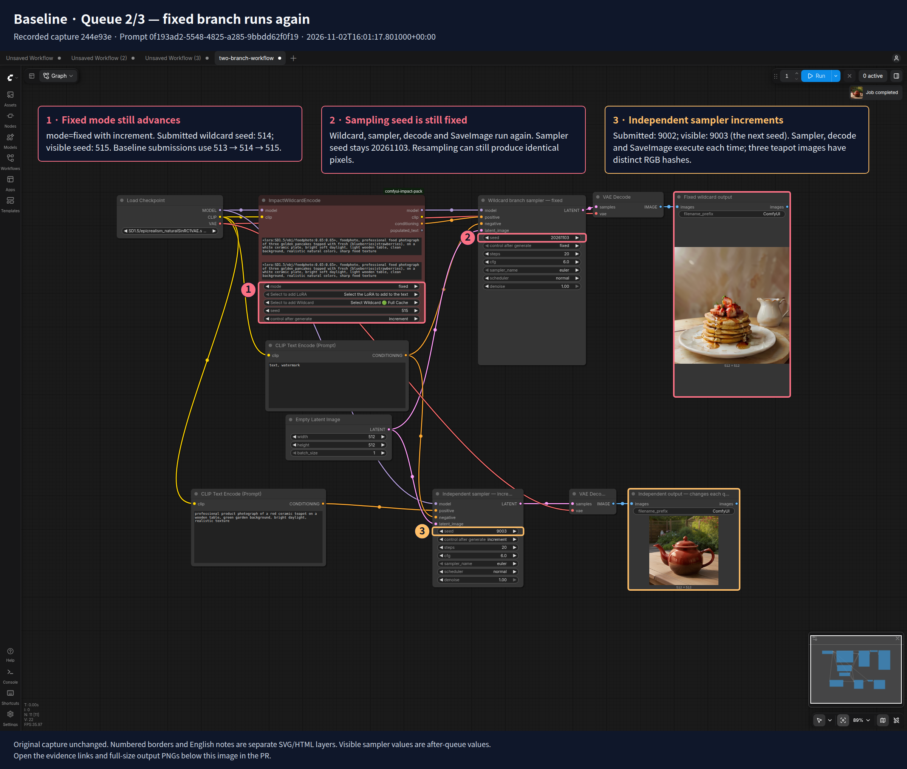](./baseline-queue-2.png)

[Original capture](../fixed-mode/seed-refresh/independent-sampler/baseline/queue-2-workflow.png) · [Queue history](../fixed-mode/seed-refresh/independent-sampler/baseline/queue-2-history.json) · [Visible widget values](../fixed-mode/seed-refresh/independent-sampler/baseline/queue-2-widget-state.json)

| Actual fixed wildcard output — pancakes | Actual independent sampler output — teapot |
| --- | --- |
| [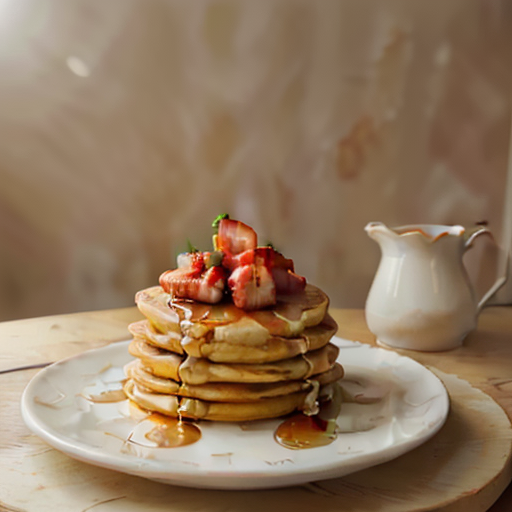](../fixed-mode/seed-refresh/independent-sampler/baseline/queue-2-fixed-output.png) | [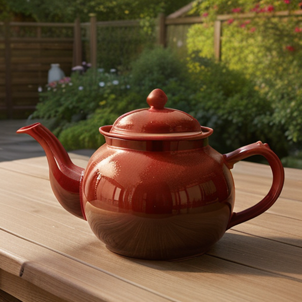](../fixed-mode/seed-refresh/independent-sampler/baseline/queue-2-independent-output.png) |

[Open full-size pancake PNG](../fixed-mode/seed-refresh/independent-sampler/baseline/queue-2-fixed-output.png) · [Open full-size teapot PNG](../fixed-mode/seed-refresh/independent-sampler/baseline/queue-2-independent-output.png)

**Patched · Prompt `d9c1d9d1-3489-415a-8842-688fe8033a86`**

[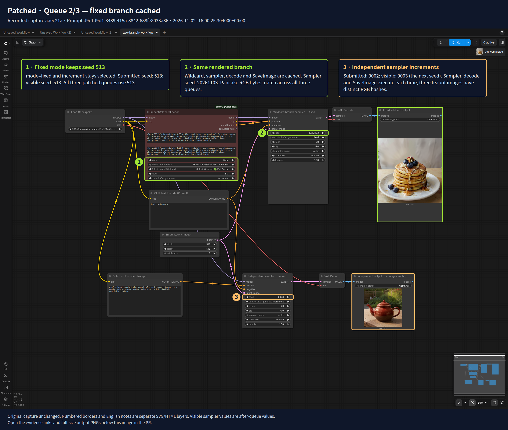](./candidate-queue-2.png)

[Original capture](../fixed-mode/seed-refresh/independent-sampler/candidate/queue-2-workflow.png) · [Queue history](../fixed-mode/seed-refresh/independent-sampler/candidate/queue-2-history.json) · [Visible widget values](../fixed-mode/seed-refresh/independent-sampler/candidate/queue-2-widget-state.json)

| Actual fixed wildcard output — pancakes | Actual independent sampler output — teapot |
| --- | --- |
|  |  |

[Open full-size pancake PNG](../fixed-mode/seed-refresh/independent-sampler/candidate/queue-2-fixed-output.png) · [Open full-size teapot PNG](../fixed-mode/seed-refresh/independent-sampler/candidate/queue-2-independent-output.png)

Queue 3/3 — after native Export/reload: baseline vs patched screenshots and actual output PNGs

**Baseline · Prompt `2303a5d1-f9f0-4236-a3e1-4ac2bd867408`**

[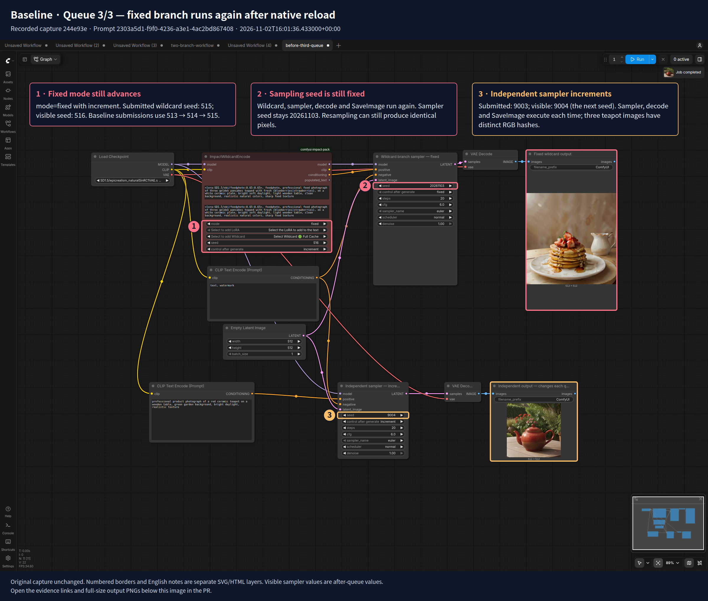](./baseline-queue-3.png)

[Original capture](../fixed-mode/seed-refresh/independent-sampler/baseline/queue-3-workflow.png) · [Queue history](../fixed-mode/seed-refresh/independent-sampler/baseline/queue-3-history.json) · [Visible widget values](../fixed-mode/seed-refresh/independent-sampler/baseline/queue-3-widget-state.json)

| Actual fixed wildcard output — pancakes | Actual independent sampler output — teapot |
| --- | --- |
|  | [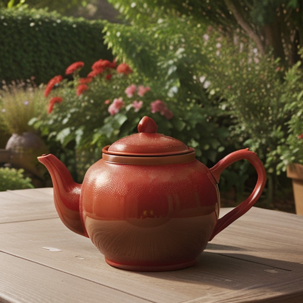](../fixed-mode/seed-refresh/independent-sampler/baseline/queue-3-independent-output.png) |

[Open full-size pancake PNG](../fixed-mode/seed-refresh/independent-sampler/baseline/queue-3-fixed-output.png) · [Open full-size teapot PNG](../fixed-mode/seed-refresh/independent-sampler/baseline/queue-3-independent-output.png)

**Patched · Prompt `d7bad13b-a736-41f1-b6c7-7b6e0c0e878e`**

[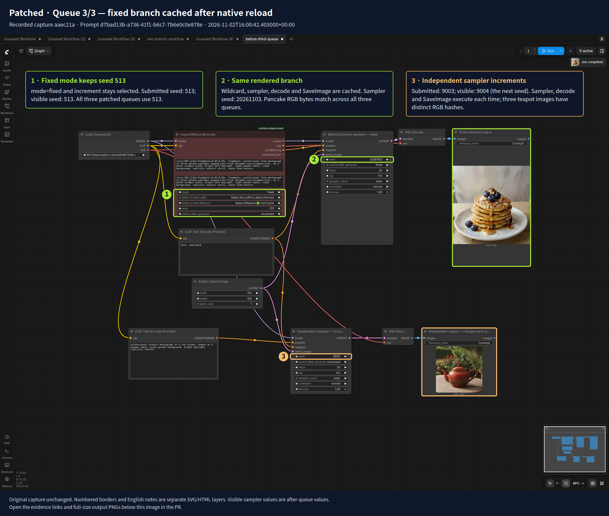](./candidate-queue-3.png)

[Original capture](../fixed-mode/seed-refresh/independent-sampler/candidate/queue-3-workflow.png) · [Queue history](../fixed-mode/seed-refresh/independent-sampler/candidate/queue-3-history.json) · [Visible widget values](../fixed-mode/seed-refresh/independent-sampler/candidate/queue-3-widget-state.json)

| Actual fixed wildcard output — pancakes | Actual independent sampler output — teapot |
| --- | --- |
|  |  |

[Open full-size pancake PNG](../fixed-mode/seed-refresh/independent-sampler/candidate/queue-3-fixed-output.png) · [Open full-size teapot PNG](../fixed-mode/seed-refresh/independent-sampler/candidate/queue-3-independent-output.png)

