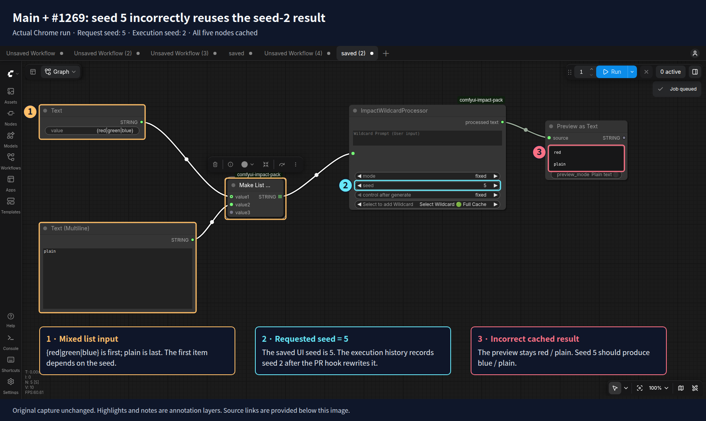
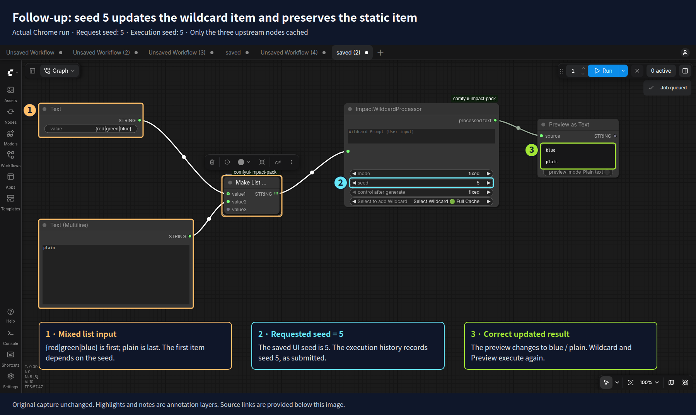
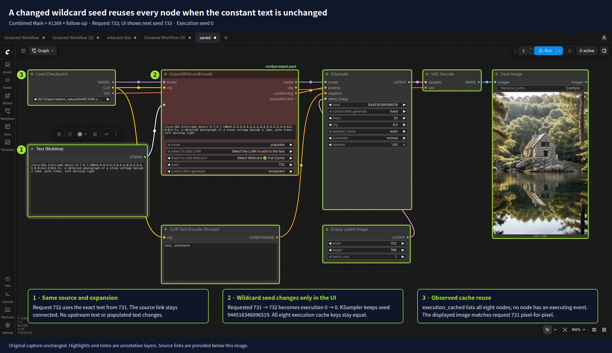
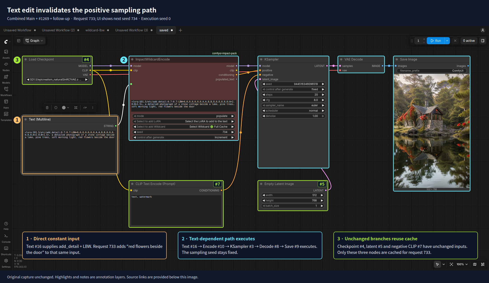

# Support constant wildcard inputs and preserve list seeds after #1269

## Intent and scope

Extend [#1269](https://github.com/ltdrdata/ComfyUI-Impact-Pack/pull/1269) for `ImpactWildcardProcessor` and `ImpactWildcardEncode`: accept direct string constants during prompt submission and keep the requested seed for text produced by lists. With #1269 alone, `[{red|green|blue}, plain]` can reuse the seed-2 result when seed 5 is requested, leaving the wildcard item incorrectly unchanged.

This PR depends on #1269. The [follow-up diff](https://github.com/ltdrdata/ComfyUI-Impact-Pack/compare/609e411e13c6da94fefb07982d63b90417122412...63d28f838c8040ade1ef122f8cd8985aef542b34) is split into [behavior and direct regression coverage `d246db9`](https://github.com/ltdrdata/ComfyUI-Impact-Pack/commit/d246db9e2736a7ef0edfca50b521113fc021ea2d) and [loader diagnostic cleanup `63d28f8`](https://github.com/ltdrdata/ComfyUI-Impact-Pack/commit/63d28f838c8040ade1ef122f8cd8985aef542b34). The branch also contains #1269's commits while that PR remains open.

Population in `on_prompt` supports literal text and direct `PrimitiveString` / `PrimitiveStringMultiline` values. An arbitrary runtime `wildcard_text` input is skipped with a server info log, retaining its existing populated text while other nodes and hooks continue; no UI warning is shown. Connect runtime text to `populated_text`, which retains #1269's eligible scalar cache reuse. Widget names, order, links and serialized values remain compatible.

**Cache behavior inherited from #1269:** hidden `UNIQUE_ID` prevents identical inputs on different wildcard node IDs from sharing cache entries, and that distinction propagates to their downstream cache keys. Repeated requests for the same node can still reuse cache. The [real-core key comparison](impact-pack-pr1269-followup-pr-assets/incoming-review/unique-id-cache-keys.json) confirms this for both wildcard nodes; it does not measure runtime cost.

## Changes

- **Resolve direct constants before execution.** Populate with the requested seed, then normalize the execution seed to `0` only for static text. Direct static `populated_text` also normalizes immediately, allowing requests queued before the first execution to reuse cache. Saved/UI seeds and seed links are preserved.
- **Keep list selection seed-dependent.** Check the selected upstream outputs and their ancestors before reusing a learned seed. List-producing paths, including V3 outputs, keep the requested seed so the last mapped item cannot determine reuse for the whole list. All-static lists also retain normal seed-based execution.
- **Preserve native restoration.** Synchronize named and positional population metadata without changing widgets. Reuse core `is_link` and remove unreachable checks after integer conversion.
- **Make regression failures visible.** Restrict the Bypass xfail to the known Processor case. Replace stale loader diagnostics with isolated tests for YAML preload, progressive TXT access and reloads. Require both API modes and all seven valid results before reporting parity.

## Verification

Chrome builds and connects graphs through the UI, submits real requests, and loads native exports in both positional and named restoration modes. Checks compare outputs, execution history, cache/execution events, widget names/order/values and links. The trusted catalog fixtures are unchanged.

| Requirement | Scenario and observed behavior |
|---|---|
| Reuse cold constant requests | Queue two requests while a separate Sleep workflow occupies the worker. Both use execution seed `0`, preserve source links, and the second reuses wildcard/preview results. The [before/after comparison](impact-pack-pr1269-followup-pr-assets/cold-queue-comparison.json) records the prior `731/732` execution seeds. |
| Preserve mixed-list selection | Test both nodes, list orders and restoration modes: seeds `2 → 5` produce `red → blue`, while the static item stays unchanged. Integration also submits a request between mapped calls. |
| Preserve scalar reuse | Concatenated static text reuses its learned seed; changing it to choice syntax restores requested-seed selection. Changing/opaque providers and linked seeds stay excluded. |
| Preserve Controls and saved workflows | Exercise Stop, Mute, Bypass, Switch, Remote Int, widget feedback and bounded countdown requeues; reload execution metadata and the complete native widget catalog. The existing Processor Bypass limitation is reported below. |
| Reuse and invalidate actual sampling correctly | With installed `add_detail` LoRA and the tutorial LBW vector, unchanged text reuses KSampler; edited text executes its dependent path. Core cache signatures agree with server events and image hashes. |

Mixed-list regression: #1269 before and the follow-up after

The source list is `[{red|green|blue}, plain]`. Seed 2 first produces `[red, plain]`. For seed 5, #1269 rewrites the execution seed to 2 and reuses the old result; the follow-up keeps seed 5 and produces `[blue, plain]`.

Sources: [submitted request](impact-pack-pr1269-followup-pr-assets/baseline-mixed-list/seed-5-request.json) · [history](impact-pack-pr1269-followup-pr-assets/baseline-mixed-list/seed-5-history.json) · [cache/execution events](impact-pack-pr1269-followup-pr-assets/baseline-mixed-list/seed-5-events.json) · [original capture](impact-pack-pr1269-followup-pr-assets/baseline-mixed-list/seed-5.png).

Sources: [submitted request](impact-pack-pr1269-followup-pr-assets/focus-mixed-list/seed-5-request.json) · [history](impact-pack-pr1269-followup-pr-assets/focus-mixed-list/seed-5-history.json) · [cache/execution events](impact-pack-pr1269-followup-pr-assets/focus-mixed-list/seed-5-events.json) · [original capture](impact-pack-pr1269-followup-pr-assets/focus-mixed-list/seed-5.png).

Actual LoRA/LBW sampling: why 732 reuses everything and 733 reuses only three nodes

The native tutorial is adapted to a cottage landscape with installed `SD1.5/etc/add_detail.safetensors`, strengths `0.7/0.7`, and its original LBW vector. A core Text (Multiline) node feeds `wildcard_text`. This checks the constant-input path with real sampling; it does not claim original-tutorial image parity.

KSampler's seed stays `944516346096519`. The requested **wildcard** seed increments, while static populated text makes its **execution** seed `0` in every row. Text A includes the LoRA/LBW tag and cottage prompt. Text B is A plus `, red flowers beside the door`.

| Requested wildcard seed | Source and populated text | Actual cached nodes | Actual executed nodes | Why |
|---|---|---|---|---|
| 731 | A | None | All eight | First execution. |
| 732 | A, unchanged | All eight | None | All execution inputs and cache keys match 731. |
| 733 | B, edited | Checkpoint `#4`, Latent `#5`, Negative CLIP `#7` | Text `#16`, Encode `#10`, KSampler `#3`, Decode `#8`, Save `#9` | The positive text changed; only its dependent path has different cache keys. |
| 734 | B, positional reload | All eight | None | Reload preserves inputs and links from 733. |
| 735 | B, named reload | All eight | None | Named restoration preserves the same execution inputs. |

Sources: [request 732](impact-pack-pr1269-followup-pr-assets/constant-lora/same-request.json) · [history](impact-pack-pr1269-followup-pr-assets/constant-lora/same-history.json) · [cache/execution events](impact-pack-pr1269-followup-pr-assets/constant-lora/same-events.json) · [original capture](impact-pack-pr1269-followup-pr-assets/constant-lora/same.png).

Sources: [request 733](impact-pack-pr1269-followup-pr-assets/constant-lora/changed-request.json) · [history](impact-pack-pr1269-followup-pr-assets/constant-lora/changed-history.json) · [cache/execution events](impact-pack-pr1269-followup-pr-assets/constant-lora/changed-events.json) · [original capture](impact-pack-pr1269-followup-pr-assets/constant-lora/changed.png).

The [input/cache-key comparison](impact-pack-pr1269-followup-pr-assets/constant-lora/node-cache-keys.json) identifies the two direct changes at 733: Text `#16` `value` and Encode `#10` `populated_text`. It recomputes ComfyUI's actual cache signatures and verifies all four transitions against server events. The [five observations](impact-pack-pr1269-followup-pr-assets/constant-lora/result.json) also record output pixel hashes: 731=732, 733 differs, and 733=734=735. The screenshots display the **next** requested wildcard seed after increment; their annotations identify the completed request.

## Results

**Fresh full regression at pushed head `63d28f8`: 575 unique pytest cases passed; 2 existing Processor Bypass cases remain xfail.** Every result in this total was rerun from a fresh archive. The [full report](impact-pack-pr1269-followup-pr-assets/full-head-63d28f8/README.md), [acceptance data](impact-pack-pr1269-followup-pr-assets/full-head-63d28f8/validation.json) and [63-file entry-point inventory](impact-pack-pr1269-followup-pr-assets/full-head-63d28f8/test-inventory.md) replace the previous cumulative summary.

| Pytest coverage | Fresh result |
|---|---|
| Wildcard/configuration units | [210 passed](impact-pack-pr1269-followup-pr-assets/full-head-63d28f8/configured-unit.xml) |
| Browser harness | [3 passed](impact-pack-pr1269-followup-pr-assets/full-head-63d28f8/browser-harness.xml) |
| Chrome cache and Control combinations, Classic | [97 passed; 2 existing xfails](impact-pack-pr1269-followup-pr-assets/full-head-63d28f8/classic/cache-controls.xml) |
| Native catalog: 198 nodes, 719 widgets | [14 passed](impact-pack-pr1269-followup-pr-assets/full-head-63d28f8/catalog/catalog.xml) |
| Native wildcard tutorials | [8 passed](impact-pack-pr1269-followup-pr-assets/full-head-63d28f8/catalog/tutorial-native.xml) |
| Switch execution and native restoration | [55 passed](impact-pack-pr1269-followup-pr-assets/full-head-63d28f8/catalog/switches.xml) |
| Remaining repository pytest suites | [188 passed](impact-pack-pr1269-followup-pr-assets/full-head-63d28f8/README.md) |

Also passed: [32 LRU-64 cases](impact-pack-pr1269-followup-pr-assets/full-head-63d28f8/verified-lru/cache.xml), [210 units with loader tests first](impact-pack-pr1269-followup-pr-assets/full-head-63d28f8/unit-reordered.xml), [20 real-core hook/cache/list groups](impact-pack-pr1269-followup-pr-assets/full-head-63d28f8/cache-hook.json), [5 CLIP/LoRA tensor groups](impact-pack-pr1269-followup-pr-assets/full-head-63d28f8/cache-tensors.json), [7 actual full-cache/on-demand API pairs](impact-pack-pr1269-followup-pr-assets/full-head-63d28f8/pair-ondemand/pair.log), and [all 11 loader shell entry points](impact-pack-pr1269-followup-pr-assets/full-head-63d28f8/legacy-with-data/results.json). Repeated configurations are excluded from the unique total. Encode uses a CLIP stand-in in the hook matrix; separate tensor and sampling checks use installed models. AnimateDiff coverage is assembly and native restoration.

Fresh [sampling observations](impact-pack-pr1269-followup-pr-assets/full-head-63d28f8/constant-lora/result.json) and [core cache-key comparisons](impact-pack-pr1269-followup-pr-assets/full-head-63d28f8/constant-lora/node-cache-keys.json) confirm the five illustrated transitions again. The full report links their new browser captures, requests/history and events. It also retains the failed setup attempts and successful reruns; none of those setup failures is counted as a pass.

**Existing Bypass limitation:** Processor with only `populated_text` connected loses `PreviewAny.source` when bypassed. Both restoration modes reproduce on [#1269 without the follow-up](impact-pack-pr1269-followup-pr-assets/full-head-63d28f8/baseline-controls/bypass.xml). Encode with the same connection, and both nodes with their first text input connected, pass Bypass/reactivation. Only the two baseline Processor cases are xfail.

The [source hashes](impact-pack-pr1269-followup-pr-assets/full-head-63d28f8/source.json) and [environment](impact-pack-pr1269-followup-pr-assets/full-head-63d28f8/environment.json) identify this exact-head run. It has one fewer unit test than the previous synthetic Main combination, as explained in the full report. The trusted widget fixtures and production branch are unchanged.

**Before merge:** #1269 must land first. Rebase only the two follow-up commits onto current Main and validate that resulting combination, including #1270. This PR remains draft until that work is complete. [Reproduction and evidence guide](impact-pack-pr1269-followup-pr-assets/pr-evidence.md).
