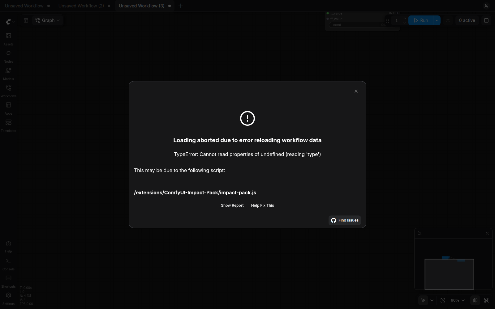
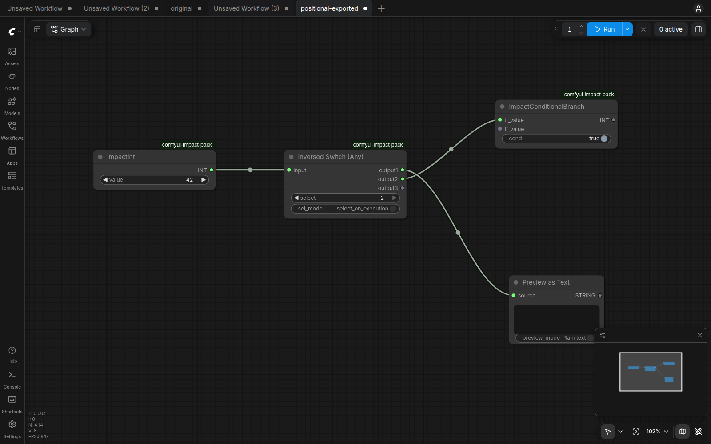
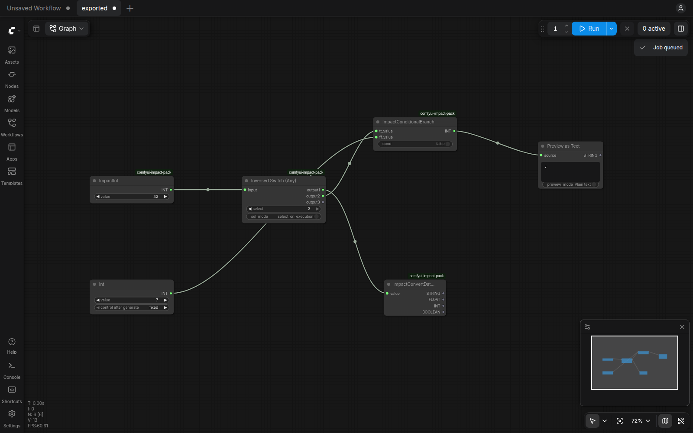

# Fix connection type restoration before upstream dynamic outputs are loaded

Related: #1250

## Intent and scope

Loading a workflow whose consumer precedes its upstream Inversed Switch can access a dynamic output slot before that slot has been restored. Reading its `type` then raises `Cannot read properties of undefined (reading 'type')`, matching the error reported in #1250, and aborts workflow loading. This change lets restoration continue using the saved link type while preserving widget values and connections.

- Affected nodes: Control Bridge, Conditional Branch, Conditional Branch (SelMode), Compare, and Select Nth Item. Four connection handlers cover these five registered node types.
- Acceptance criteria: when handling an input connection, use the saved link type if the upstream node or output is unavailable. If neither type is known, retain `*` so a later connection notification can resolve it. An available upstream type takes precedence; Compare retains its BOOLEAN output.
- Compatibility: preserve existing widget names, order, and serialized value mappings. No nodes, settings, or workflow migrations are added. Refresh the browser after updating to load the changed JavaScript.

## Changes

- **Preserve valid types during partial restoration:** guard output-slot access in `js/impact-pack.js` and resolve the type in this order: upstream output, saved link, then `*`. This also prevents assigning `undefined` after merely suppressing the exception. Remove four unused callback variables in the affected handlers.
- **Make standalone Chrome setup reliable:** dismiss the initial template browser in the shared E2E helper so workflow controls can receive input on a fresh browser profile. This test-only change is a separate commit; the corrected wildcard UI run and three helper regressions pass.
- **Protect restoration and saved workflows:** add unit tests of the shipped extension callbacks and Chrome tests covering native Export/load/re-export/load. Reuse the shared browser fixture and existing export/widget helpers. Document the commands in `docs/E2E_TEST_STRATEGY.md`. Execute all five restored consumers through the real queue, including changed branch/comparison/list controls and Control Bridge Stop/Mute/Bypass behavior. Keep the trusted workflow and widget snapshot unchanged.

## Validation method

Tests ran in isolated ComfyUI installation and user directories. Production-file hashes are recorded. The completed targeted run used `2b96af7`; the full run validates the separate browser setup correction in `4434abd`. The final `309aeaf` follow-up adds ten execution cases against an isolated `--cache-none` server; served production code is unchanged. These cases use real queue histories, visible preview text and Bridge continuation requests without mocking websocket events. Unit tests load the actual `impact-pack.js` with mocked app/API/common imports. Chrome tests use the real local ComfyUI server and frontend, creating nodes, connecting them, exporting, and loading workflows through UI interactions. Graph APIs are used only for observation. Expected widget names, order, and non-default values are declared independently of runtime observations.

| Contract | Scenario | Observed result |
|---|---|---|
| Type resolution | Five node types, each with a missing upstream node, missing output slot, unknown type followed by another connection notification, and conflicting upstream/link types | Saved types are restored; unknown types remain resolvable; upstream types take precedence; Compare keeps its BOOLEAN output |
| Restoration order and widget compatibility | Five node types × two creation orders × positional/named restoration: 20 Chrome cases connected to the Inversed Switch's dynamic second output | Both native loads restore every data input/output type; rendered widgets and both serialized value representations match explicit expectations; links remain unchanged |
| Restored node execution | Five consumer-first node types × positional/named restoration, executed after both native loads | Branches return 42/7, Compare returns True/False, Nth selects 7/42 from [42, 7], and Control Bridge passes/blocks/resumes values and changes Mute/Bypass/Active modes through real continuation |
| Existing saved workflows | Registration coverage plus positional and named loading of the fixed catalog | All 198 registered nodes occur exactly once, and rendered widget names/order/values match the trusted snapshot |

The same regression tests were run against the pre-fix production code (`244e93e`). Unit tests produced 15 failures and five passing controls. The consumer-first Conditional Branch Chrome case failed during native loading. Its browser trace contains the actual `undefined.type` exception; a subsequent UI timeout alone was not counted as proof of reproduction.

Three isolated mutations tested assertion sensitivity: removing the fallback, giving saved link types priority over available upstream types, and leaving the second input at `*`. Unit tests rejected all three mutations. Chrome also rejected the second-input mutation with a concrete type mismatch. Two additional backend mutations also fail on concrete wrong outputs: Stop incorrectly passing 42 instead of blocking, and Nth returning the first item instead of the selected last item. The new execution test also reproduces the original `undefined.type` failure with pre-fix JavaScript. All mutations were applied only to disposable validation copies.

## Validation results

- Target: `Main` ← `fix/issue-1250-connection-types`.
- Final head: `309aeaff9775f611e32fa3cb58b73f943258060d`. Production files are unchanged from `2b96af7`. The full regression used `4434abd`; the final commit adds the ten execution tests and their documentation. The original twenty loading tests are unchanged. Runtime and trusted-fixture hashes match the recorded source. The worktree is clean and whitespace checks pass.
- Full PR diff (`origin/Main...HEAD`): five files, 352 insertions and eight deletions. Merge base: `244e93e`; checked Main: `082523b`. The final merge-tree check is conflict-free. The merged integration tree was not executed.
- Environment: Linux, ComfyUI 0.43.0, frontend 1.57.6, Chrome 155.0.8059.84, Python 3.12.3, Node.js 20.19.5. Isolated CPU servers and an RTX 4080 were used. Image parity runs used deterministic FP32 settings and the installed original checkpoint/LoRA assets; no model overrides were needed.
- **The full regression sweep is complete. Maintained suites passed after the corrections and reruns described below. Three legacy wildcard failures remain and also reproduce on Main.**

**Screenshot evidence: native workflow restoration**

Both captures use the same consumer-first workflow file. The Before image is the original failure capture; the After image was captured with served JavaScript byte-identical to the final head, after native Export and reload. These are unedited browser screenshots.

**Before — `244e93e`:** Chrome aborts loading with `Cannot read properties of undefined (reading 'type')` and identifies `impact-pack.js`.



**After — `4434abd`, positional restoration:** all four nodes load. Inversed Switch `output2` remains connected to Conditional Branch, whose output is `INT`; the saved values remain `42`, `select = 2`, and `cond = true`.



The same native round trip also passed with named widget restoration: [named-restoration screenshot](impact-pack-issue1250-pr-assets/full-20261102T235036Z/connection-screenshots/after-named.png). The [capture record](impact-pack-issue1250-pr-assets/full-20261102T235036Z/connection-screenshots/evidence.json) includes the workflow/source/image hashes, observed widget names/order/values and both `INT` data-input types. Screenshots show loading and visible controls; the recorded assertions verify types and serialized links. No inference was queued for these captures.

**Execution after reload — named restoration:** the exported workflow first produces `42` with `cond = true` ([capture](impact-pack-issue1250-pr-assets/execution-20261103T022327Z/output-screenshots/branch-true.png)). Changing `cond` to false and running again produces `7`, shown below. The connection to dynamic `output2` and both source values remain visible.



[Execution evidence](impact-pack-issue1250-pr-assets/execution-20261103T022327Z/execution-validation.json) contains all ten cases and 76 queue histories: 68 successful executions plus eight intentional Control Bridge interruptions followed by successful continuations. The consumer results were not cached. These counts exclude the two supplementary screenshot runs.

| Scope | Result | What was checked |
|---|---|---|
| JavaScript regression | 29 passed | Connection types, legacy SAM registration, LoRA source behavior |
| Offline pytest suites | 369 passed | Wildcard/config/seed behavior, masks, AnimateDiff tensor assembly, shared browser helper |
| Workflow/catalog suites | 93 passed | Connection restoration, switches, mask workflows, all 14 catalog tests; 198 registered nodes and both widget restoration modes |
| Restored dynamic consumers | Ten passed | All five nodes execute after both native loads; both restoration modes; Stop/Mute/Bypass and reactivation included |
| Wildcard queue/cache | 24 passed after one rerun | 20 classic-cache cases plus four LRU cases, including linked providers and a subgraph text provider |
| Original wildcard tutorials | Nine passed | Eight native-restoration cases and one LBW inference case with exact RGB equality against independently captured Main output |
| SAM browser/API suites | 19 passed after server isolation | Six editor cases, ten mask/tutorial cases with real SAM weights, three API cases |
| LoRA source restoration | Two passed | Delayed selection responses and native saved widget values |
| Standalone browser scripts | Eight scripts passed | Full-cache/on-demand wildcard UI, Detailer, conditioning, switch tutorials, regional sampling, AnimateDiff native loading, LoRA inference |
| Integration/validation scripts | Five scripts passed | Input validation, wildcard cache behavior, real LoRA/CLIP tensors, SDXL and Inspire LBW tutorial tensors |
| Encoding HTTP suite | 15 cases passed | Tracked encoding samples through the running server |
| Legacy wildcard pytest | Eight passed, **three failed** | Identical failures reproduced on checked Main |

The maintained pytest totals are **369 offline + 157 server/workflow case executions** (516 from the full sweep plus ten new execution cases), with zero skips. Successful reruns replace the failed attempts in these counts; the four LRU executions are additional cache-mode coverage. The initial failures remain in the evidence. The earlier preliminary execution run is not counted again. Standalone scripts, baseline runs and legacy diagnostics are not added to these pytest totals.

Observed model checks include exact core-node pixel parity across LoRA modes and native reloads, exact Main parity for the original LBW tutorial, real SAM masks, Detailer inference, and localized changes in all three regional prompts. Native-only tutorial checks do not establish full tutorial inference.

Exceptions and failure triage:

- **Outstanding legacy failures:** `test_wildcard_list_functions` and the two on-demand mode checks fail with the same assertions on Main and this branch. Their setup assumes old internal state/import behavior and private wildcard data. These tests and product behavior were not changed to obtain a green result.
- **Historical shell diagnostics:** all six remaining root shell suites ran in disposable copies with PID-scoped cleanup. Their zero exit codes are insufficient proof: the edge-case suite prints PASS for unresolved wildcards, deep-nesting checks emit 18 warnings, and one quoted-path check fails because its fixture is absent. Fixture-dependent coverage is recorded as inconclusive, not passing. Historical private-data helper scripts are listed separately in the coverage audit.
- **Browser setup:** the initial standalone wildcard run was blocked by the template browser; the shared helper now dismisses it. The corrected run and three helper checks pass. The SAM editor's six initial failures came from Inspire importing the deprecated UI module that the test globally forbids; all six unchanged cases pass on an Impact-only server.
- **Interruption and UI flakiness:** the CPU run ended with SIGTERM after 72 completed passes; exactly the 21 unfinished cases were resumed and passed. One classic-cache case timed out opening node search before its product assertions; its unchanged coordinates/assertions passed on an isolated CPU rerun. The original GPU run passed the matching named-restoration case. The timing cause remains unproven.

Limits: one installed frontend version and hardware configuration; no full AnimateDiff video inference or SDXLPromptStyler/BNK inference. The issue supplied no original workflow, so the dedicated regression uses the reproduced native-loading path. Trusted catalog fixtures were never regenerated.

Representative commands from the worktree, using the configured isolated server (`--cache-none` for connection execution):

```bash
node --experimental-vm-modules --test tests/connection_types.test.mjs tests/legacy_sam.test.mjs tests/lora_wildcard_source.test.mjs

/home/rho/venv/bin/python -m pytest tests/test_e2e_connection_types.py tests/test_e2e_switches.py tests/test_e2e_switch_loading.py tests/test_e2e_widget_catalog.py tests/test_e2e_mask_to_segs.py tests/test_e2e_mask_tutorials.py -v --tb=short

/home/rho/venv/bin/python -m pytest tests/test_e2e_connection_types.py -k consumer_executes -v --tb=short

/home/rho/venv/bin/python -m pytest tests/test_e2e_wildcard_cache.py -v --tb=short

IMPACT_E2E_REFERENCE_IMAGE=/mnt/teratera/git/impact-pack-issue1250-pr-assets/full-20261102T235036Z/lbw-main-reference/reference.png \
  /home/rho/venv/bin/python -m pytest tests/test_e2e_wildcard_tutorials.py -k inference -v --tb=short
```

[Full regression report, commands and outcomes](impact-pack-issue1250-pr-assets/full-20261102T235036Z/full-regression-report.json) · [Source and fixture integrity](impact-pack-issue1250-pr-assets/full-20261102T235036Z/final-source-integrity.json) · [Coverage inventory](impact-pack-issue1250-pr-assets/full-20261102T235036Z/coverage-inventory.json) · [Legacy shell audit](impact-pack-issue1250-pr-assets/full-20261102T235036Z/legacy-shell-audit.json). The evidence directory contains per-suite logs, JUnit reports, server commands, native exports, screenshots and browser traces.

[Post-load execution report](impact-pack-issue1250-pr-assets/execution-20261103T022327Z/execution-validation.json) · [Final code/test review](impact-pack-issue1250-pr-assets/execution-20261103T022327Z/final-review.json).

Earlier targeted evidence: [baseline browser exception](impact-pack-issue1250-pr-assets/review-20261102T164134Z/baseline-error-summary.json), [red/green and mutation verification](impact-pack-issue1250-pr-assets/review-20261102T164134Z/verification.json), [review findings and resolutions](impact-pack-issue1250-pr-assets/review-20261102T164134Z/review.json).
